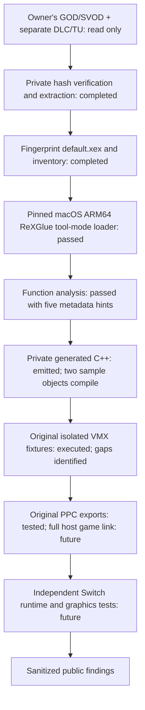

# Proposed architecture — Phase 20

**Current Phase 20 gate (2026-10-24): VERIFIED in static/original-synthetic scope.** A frozen entry region has 19 permitted instructions plus one pre-call exit word, two selected ranges, four blocks and 19 normal edges. Its eight stores remain unmediated in the preserved game output. B01 is closed only for this region; B06 has static identities and a separate original proof: 74/74 emitted/observed stop sites and 72/72 edges. Final regressions pass 629 core checks. Exception metadata and differing PE/XEX image bounds remain execution dependencies. Phase 21 synthetic contracts are CONDITIONAL GO; private game execution is NO-GO. [Exact confidence, evidence and remaining gates](research/bounded-entry-region-cfg.md).

The architecture remains a **proposal**, with intake, host loading and configuration-assisted analysis/generation tested on the supplied game. Full port implementation has not started.

## Frozen region and control-policy boundary

The Phase 20 selector reconciles current XEX header facts, preserved loaded-image PE/PDATA, independently decoded actual PCs and the existing generated instruction/function/callee/link/branch mappings. A meaningful stack/data initialization stage ends before an unverified initializer. Normal control is finite and closed; shared suffix aliases and exceptional continuations are not additional admission targets. Detailed addresses/operands and canonical region/dependency records remain private.

An original XEX analogue uses production before-instruction hooks, immutable hash-bound manifests and exact context/target admission. Conditions, calls, shadow caller returns, joins, loops, imports, exits and refusals are checked. Existing generated-import policy is unchanged: the opt-in CFG seam chooses an explicit native or imported target and has no fallback. Checked memory, actual XThread/TLS/PCR, image leases, native join and final-owner cleanup remain required. This is an original fixture policy, not automatic title launch or a native C++ sandbox.

B01 is closed only for the selected normal-flow region; the wider title graph is not complete. The 20 private planned sites have no new emitted hooks or execution evidence. Before any private execution, verify actual memory mediation, consumed initial state, code/owner binding including PE/XEX bounds, and exception refusal. The entry owner has an intersecting exception scope: a missing normal CFG edge is not proof that exceptions cannot occur. Full guest unwind remains unsupported. [Evidence and B01–B09 ledger](research/bounded-entry-region-cfg.md).

## Fixed-base synthetic XEX binding

Production codegen now consumes original XEX images whose PDATA supplies function discovery. XexBinding compares actual loaded image/entry/sections/code/TLS/import metadata with the emitted PPCImageInfo and mappings before admission. Compiler-only namespacing permits two fixed-base products in one fixture executable without changing guest addresses. Patch 0019 adds a separate leased, owner/section/page-checked image-copy path; the original virtual-copy path still rejects XEX and fetch remains unsupported. Generated RO/RW image references use this path. Phase 17 extends the three reviewed pointer adapters with explicit image capabilities while preserving opaque-buffer contracts.

The single workflow reconstructs all SDK patches and historical controls, then tests three profiles and the prior suites. Native harness startup, fixed-base construction and cooperative/fail-stop lifetime policy remain explicit boundaries. General DLL relocation, arbitrary native isolation, title cancellation and Horizon behavior remain unverified. [Contracts and measured coverage](research/synthetic-xex-binding.md).

## Generated stop boundaries

The original encoder produces a nine-function XEX with finite, infinite, nested, checked-memory and SDK-call loops. Existing production midasm_hook configuration emits checks before whole PPC instructions, including all six backward branches, function entries, memory operations and pre/post-call boundaries. Independent PPC/emitted-C++ auditing refuses missing coverage before execution. Generated C++ is not manually edited, and the pinned nineteen-patch SDK remains unchanged.

GeneratedStop validates the current context and allowed PC, consumes an idempotent thread-safe request and throws a private typed host completion signal. Ordinary C++ scopes unwind to the matching execution boundary; the host restores its PPC checkpoint for native cleanup. Active imports finish before the post-call point. Join/final-owner reclamation still precede unload. The unhooked benchmark admits only a count-bounded memory loop with equivalent checked inputs. General CFG policy, guest unwind, interruptible SDK instructions and title cancellation remain unsupported or unverified. [Coverage, ownership and measured costs](research/generated-loop-stop-boundaries.md).

## Image pointer and cooperative-stop scope (Phase 17)

An explicit Image-tagged PointerBinding retains a birth image lease and obtains a fresh lease for every import. Exact import-module identity, single-section bounds, page/PE permissions and wide-integer checks precede the actual SDK call. RO IN succeeds; RO OUT/INOUT fails. Snapshot/scratch/readback/final checked commit preserve the original three synchronous contracts and reject callback reentry. Failure rolls back only that import's output. A retained capability prevents image replacement until released; closing admission refuses new calls.

The original CooperativeStop state machine places a safe boundary after the bounded synthetic body/import completes. The Phase 17 path does not interrupt generated instructions or synchronous imports; Phase 18 adds checks inside original generated execution. Real SDK Exit and native join precede final XThread/TLS/PCR and module reclamation. Observer-driven races, concurrent callers, failed initialization, callback errors and expected join fail-stop remain bounded by external watchdogs. Host scheduling is PARTIAL; arbitrary guest cancellation and guest exception unwind are unsupported. [Exact ownership and measured limits](research/image-backed-pointer-shutdown.md).

## Phase 15 generated PPC import caller (historical)

The original Phase 15 raw-test program is decoded/emitted by the pinned CLI and compiled unchanged. Its generated entry and scalar callee mediate all 30 reachable guest-memory sites, prepare pointer and stack arguments, execute scalar/full-vector/TLS operations and branch on actual SDK results. A narrow thread-local GeneratedImports seam routes explicit original gate identities through the existing admission and copy adapters; unregistered targets have no fallback. Actual XEX loading supplies image/import/TLS metadata. Host-authored rebasing/registration and caller setup remain an explicit PARTIAL boundary rather than automatic XEX codegen integration.

Execution and per-import image leases, original capability buffers and real XThread ownership cover four concurrent callers, active-call unload/release refusal and repeated cleanup. The checked Scope adds local attempt/completion counters; SDK patches and contracts remain unchanged. Full native C++ isolation, guest exception unwind, title ABI and private game instrumentation are not supplied. [Measured scope and remaining gates](research/generated-ppc-end-to-end-dispatch.md).

## Checked pointer import dispatch

The opt-in admission boundary now has three explicit PointerBinding signatures. Actual SDK implementations receive private, owner-tagged scratch addresses; guest buffers are read and committed only through bounded owner/page/protection checks. Facade operations serialize through the call, with explicit nonblocking busy release and guarded callback reentrancy. Final full-span validation refuses external release/protection changes without partial output or false success. Module leases cover each call separately from thread-TLS image ownership.

The historical Phase 14 host-driven path uses real synthetic XEX loading, header TLS, import records, direct/indirect admission, copy adapters, SDK shims and cleanup. Its native XThread driver does not execute XEX entry instructions. This is not transparent instrumentation of private generated callers or a native sandbox. IN snapshot semantics, same-owner query targets and nonretaining synchronous imports define the verified scope. [Contracts, concurrency, ABI and limitations](research/pointer-import-synthetic-dispatch.md).

## XEX TLS and import admission

XexModule validates bounded header metadata before continuation succeeds. XThread's default Create binds the executable module; explicit CreateWithModule supports original independent module scopes without replacing the global title process. Its retained image lease lasts through final TLS/PCR release. Scratch/TLS/PCR/native-create failure paths restore partial allocations and refuse success. Out-of-range process TLS free now returns the existing false result before bitmap mutation.

The original host admission adapter checks a fresh image lease, actual XEX import membership, exact library/ordinal/name/type, supported signature, and matching XThread/PPCContext/PCR for TLS. Six reviewed value-only shims remain callable without a pointer binding. Phase 14 adds three explicit pointer-scoped overloads; other pointer/wait/handle/fatal/unknown contracts remain denied. This adapter is opt-in and is not wired into unchanged private generated game imports. Header-driven template copying and 64-slot title-process allocation are verified; arbitrary DLL TLS-index policy and title scheduling remain PARTIAL. [Ownership, policy and boundaries](research/xex-tls-import-admission.md).

## Binary selection and update boundary

The initial baseline is only `default.xex`, SHA-256 `636a8036b630ae64acb582de4ac7303b8435de808f67e5343f1ddebc74d29456`, Title ID `454108C5`, Media ID `7DD5E14B`. Base DLC/update extractions stay separate. The title update's source-version field matches the base version but it has not been applied or completely validated.

Do not infer modules from extensions: `live.dll` is an XEX executable/header variant at the same preferred base/entry, with a byte-identical stored payload but changed identity/version headers. It was not passed to `--scan-dll` or registered as a second module. Establish actual module-load paths before including it. Any updated/alternate baseline needs new hashes and its own complete analysis results.

## Host and target separation

**VERIFIED host path:** official ReXGlue 0.10.0 macOS ARM64 release at tag commit `f5337cdc947ff6d4c4196737e2c807a48f2a1fc2`. The CLI and a small original tool-mode metadata helper run on the existing Mac; no SDK/dependency build or Linux environment was needed for that initial analysis. Phase 7 separately builds the SDK and dependencies natively. [Exact commands and artifact fingerprints](research/phase2-commands.md).

**VERIFIED:** configured analysis and private C++ emission complete; two sample partitions compile to Mac objects. [Phase 3 findings and measurement limitations](research/rexglue-analysis.md).

**Not yet validated:** complete CPU semantics, host game link/runtime and Horizon cross build. Keep all local manifests, generated glue, code, decoded images and outputs outside the public checkout. Host codegen tools and target runtime libraries are separate build inputs.

## Phase 11 original synthetic module

[The synthetic execution report](research/synthetic-execution.md) exercises the actual pinned `recompile-tests` CLI on an original 144-byte PPC module: nine complete functions, real decoder/emitter/templates, unchanged generated translation unit, checked-memory opt-in and matching patched SDK. An original fixture loader separately reserves/commits code, RO and RW sections, applies one supported data relocation and admits only registered entries. This raw-test pipeline is not production XEX loading, GapFill or title startup.

Two actual guest XThreads execute mediated native-stack/PCR/TLS, scalar and full-vector operations using explicit non-owning scope loans. Patch 0015 admits ordinary virtual 64-KiB stack pages under the existing locked owner/extent/protection checks. Patch 0016 fixes macOS exit ownership: private host completion unwinds execution/callback scopes while backing remains live, then guest finalization runs and native cleanup releases the exact execution handle. The object table and any caller/lookup/copy owners keep PCR/TLS live until their final release. The old stranded local Exit reference is removed from the supported Mac path. Creation failures balance leases and do not publish process linkage or retain native callback storage.

**VERIFIED synthetic scope:** all 20 new execution/lifetime groups pass in each profile; the unchanged critical teardown oracle reports two thread/frame destructors and zero retained PCR/TLS regions. A separate debugger trace verifies actual pointer-reference transitions. Foreign asynchronous termination fails before mutating state on Mac; cooperative self termination and the real ExTerminateThread export are tested. This is host lifetime control, not guest exception dispatch/unwind. Other host/target platforms, APC/fiber/catch-all interactions and normal title ABI initialization remain unverified.

**Phase 12 NO-GO:** private generated game output is unchanged and uninstrumented. XEX/image ownership/relocations, execute authorization, TLS/TOC/import contracts, unknown dynamic targets, atomics/partial vectors, typed-vector ABI, cooperative title stop and guest exceptions remain gates. Exact next work is original synthetic XEX/image and required-import admission before a separate bounded private-execution readiness review. No complete guest isolation or native C++ sandbox is established.

## Historical Phase 10 generated-access prototype

[The instrumentation report](research/generated-memory-instrumentation.md) connects the real generator's PCH macros to the original Phase 9 allocation layer. An explicit compile-time opt-in selects checked scalar/finite-FP/full-vector transfers. Full vectors have named macro seams; raw/atomic/partial-vector/string operations fail explicitly. Direct emitted calls share a policy macro and synthetic indirect calls use an explicit host allowlist. Matching seams exist in the SDK test-PCH template. The default mode retains the original runtime behavior.

Original encoded PPC words pass through the actual decoder, builder and template before compilation/execution. Selected page, ownership, endian, alignment, failure and concurrent contracts are checked independently. The checked generated body receives a null arena base. This is a controlled original fixture boundary, not a native-code sandbox, checked instruction fetch, complete ABI, guest exception delivery or title memory integration.

**NO-GO for proprietary execution:** private generated output is unchanged and uninstrumented; old literal calls/raw vector bodies require reviewed regeneration, not just a header substitution. Image/stack/TLS capabilities, required imports, indirect targets, atomic/partial-vector semantics and guest unwind remain unresolved. Phase 11 should admit and validate an original mini-module before any title execution proposal.

## Phase 9 checked guest-access boundary

[The entry-readiness report](research/guest-memory-entry-readiness.md) adds an original opaque-handle adapter and a locked, bounded SDK copy primitive on the actual 4-KiB virtual heap. Each supported transfer validates owner/reservation, commitment, permissions, overflow and all pages before copying. Unique lifetime tokens and the heap lock cover the copy against ordinary free/protect operations; requested byte bounds are enforced by the adapter. MMIO and its host-page padding are refused. Read/write/endian, cross-page and selected concurrent operations use original fixtures; no guest backing pointer escapes through this API.

**PARTIAL coverage:** existing generated accesses, SDK mapped pointers, stack marshalling, atomics, physical aliases and raw memory helpers remain unmediated. Fetch is explicitly unsupported because guest execute permissions are absent from the pinned page table. Reset/restore/teardown and MMIO registration require quiescence. No complete guest memory isolation, title lifetime or Xbox ABI claim follows.

Thirteen pinned patches are built coherently in private. A new import regression exposed NtClose accepting a previously closed handle; its existing INVALID_HANDLE branch now rejects empty/exhausted entries before decrement. The direct entry closure contains 108 generated functions and 33 imports, with 21 unresolved indirect sites and zero mediated generated memory sites. **NO-GO for proprietary execution.** Phase 10 must first demonstrate original emitted-access mediation and fail-closed dispatch/import policy.

## Phase 8 pre-entry safety boundary

[The pre-entry report](research/pre-entry-safety.md) records eleven ordered SDK patches with clean coherent runtime/codegen builds. XDBF uses bounded byte decoding; allocation size/alignment are checked before narrowing and zeroing. The saved nearly-4-GiB allocation SIGBUS is preserved as a pre-fix regression, with arithmetic-only boundary tests preceding any fixed-runtime retry.

XamFree now requires an owner token in the actual heap, using the runtime's XamModule instance. Release/reset/new reservations clear owner records; ordinary foreign blocks and stale XAM addresses reused by foreign allocations cannot be freed through XamFree. This is host-side provenance, not a guest capability, complete object bounds or same-owner ABA detection. XamAlloc OOM and three unsupported exception exports fail explicitly at the host boundary; Xbox failure values and guest unwind remain unverified.

Guest views start NOACCESS and committed allocations determine host protection. Selected virtual/physical reserve/decommit/release/read-only denials and explicit guest-range checks are verified. **A 16 KiB host page cannot independently protect all four 4 KiB guest pages.** Raw generated accesses can still reach slack while an adjacent committed page needs access; logical checks are not automatically inserted into those accesses or pinned against concurrent lifetime changes. MMIO and signal tests remain selected host contracts.

**Historical Phase 8 gate — NO-GO for generated-game execution:** checked guest-access integration and a fail-closed entry/import policy must precede any trace. Typed vector marshalling, full Xbox ABI, error-status compatibility and guest exception dispatch/unwind remain incomplete. No game function, entry or boot is executed in this milestone. Historical Phase 7/6 limitations below describe their original snapshots; current safety findings above supersede the resolved XDBF alignment and allocation false-success paths within the tested scope.

## Phase 7 unified SDK boundary

[The unified SDK report](research/unified-sdk.md) establishes a clean pinned source build with seven ordered patches, matching runtime/codegen headers and libraries, and full supported C-family ASan/UBSan instrumentation. Real Memory, MMIO, signal dispatcher, thread binding and export calls now come from one newly built library. The isolated recipe does not install or register a global SDK. The GPU plugin is not built or run.

The original matrix passes 131 fixture/fault checks plus six watchdog checks at Debug/optimized/sanitized settings. Selected 64-bit GPR/stack and nested callback/r2 defects are corrected; real XThread/TLS boundaries, invalid-free failure propagation and STFS explicit rejection pass. This supersedes Phase 6's hybrid-library limitation within the tested contracts. It does not establish complete Xbox ABI or title launch initialization.

A private Debug loader-only probe recognizes all 274 imports, while the sanitized probe aborts on misaligned XDBF endian-field access. XamAlloc OOM false-success, exception stubs, typed-vector marshalling and writable unallocated guest holes remain blockers. Complete generated game linking is untested; symbol presence is insufficient. **Phase 8 NO-GO for generated-game execution:** first repair loader decoding with independent bounded-resource tests and review fail-closed entry/import/pointer prerequisites. No guest entry is prepared or executed.

## Historical Phase 6 original PPC execution boundary

[The original PPC harness](research/ppc-execution.md) now calls 13 verified SDK exports with a real PPCContext, Memory, KernelState and XThread lifecycle, without loading an XEX. Direct-call register preservation, endian/mapped access, selected allocation errors, process TLS slots, PCR/r13 and two-thread isolation pass O0/O2 and limited ASan/UBSan checks. Original fixtures additionally test selected stack/FPR marshalling. r2 preservation does not establish title TOC initialization or callback ABI correctness.

The Phase 5 read-only write hang is an unclaimed synchronous signal retry in the SDK dispatcher: protection works, but a declined fault returns to the same store. External 30-second process-group watchdogs, sampled stacks and compact fault records establish the cause. A separate dispatcher patch provides fail-stop; a controlled claimed fault resumes after an original fixture store while leaving its page read-only. This is host recovery, not guest unwind.

Patches are applied only in isolated private copies. Complete memory/I/O/threading export units and exact real-class TLS methods link beside the unchanged prebuilt SDK; shim ownership is checked. At that milestone, a coherent rebuilt SDK dispatcher/MMIO/thread binding was still required; Phase 7 now tests that integration above. The new protection-output conversion and prior STFS/TLS corrections pass selected real-context tests, but unsupported STFS remains a functional blocker.

The [Phase 5 foundation](research/runtime-foundation.md) remains an independent bounded checked arena, host-thread TLS and diagnostic error component. It does not insert bounds checks into generated accesses or replace SDK/Horizon mappings. Full callback/64-bit ABI, guest dispatch/unwind, fibers/APCs, VMX numeric truth and target memory behavior remain unresolved. No game-derived execution or full game linking is added.

## Phase 4 validation boundary

The [isolated VMX tests](research/vmx128-validation.md) compile the actual pinned SDK emitter case using original operands and compare its output to a separate numerical oracle. They do not consume game code or reproduce the full FPSCR/runtime environment. Finite in-range results and mask 2/3 equivalence pass; same-register aliasing is defective relative to snapshot semantics, and overflow/infinity become NaNs. Xbox hardware equivalence remains UNKNOWN. None of the 237 static game float16_4 sites aliases its source/destination registers.

The [runtime audit](research/runtime-audit.md) maps every imported function to source behavior: 7 IMPLEMENTED, 184 PARTIAL, 61 STUB, 9 UNKNOWN. Preserve the distinction between symbol binding, a host implementation, a Horizon adapter and observed guest behavior. Host exception recovery/FP state patches do not supply guest unwinding. STFS container parsing does not supply guest I/O-manager STFS device operations.

The half-float numeric gate remains open: pinned Canary and Xenia/ReXGlue software paths disagree, and public DirectXMath notes warn of an Xbox-specific variant. Only the alias dependency fix is applied in the separate SDK patch; no numeric change or game regeneration is made.

## CPU and runtime contract

The actual image is PE32 PowerPC big-endian, with `.text` and a separate executable BINK section, `.pdata`, TLS, kernel imports and static-library records. Preserve guest register/ABI semantics, endian and VMX128 lane behavior, atomics/reservations, FP status/rounding, indirect dispatch, TLS, callbacks and exception flow. None is proven by parsing or by the presence of a host shim.

The loaded allocation is `0xD70000` bytes; exact preferred base and entry identities stay in the private metadata inventory. Header stack is `0x40000`; TLS declares 64 slots and 28 bytes of raw/data. No heap budget or total resident memory is established. The PE declares 14 sections; ReXGlue's analysis view uses 13 and skips `.reloc` beyond the loaded image end. Arbitrary rebasing remains unproven.

All 274 import ordinals resolve and 261 function shims exist, but source review identifies imported exception/unwind and STFS stubs. Determine which paths are exercised before replacing APIs. Required classes include threads/APCs/events/waits, memory/physical mappings, files/content/saves, XAudio/XMA, controller APIs, Vd GPU calls and module loading. [Binary/runtime evidence](research/xbox360-analysis.md).

## Graphics and asset path

**INFERRED first candidate:** adapt a reviewed native PM4/register-to-Vulkan renderer through Mesa/NVK using the architecture of [project8-sw](https://github.com/R-drg/project8-sw/tree/3393f2615deb7e8ac11ce51d2cd0e9defded5669), with the [Simpsons](https://github.com/R-drg/the-simpsons-game-nx/tree/3cb2cdf7fa1665a1f2d653aa7502fe4baa03680f) and [Mercenaries](https://github.com/penettrator/Mercenaries2-NX/tree/65167852496f94b278a82ffea465c51703575f01) integrations as comparisons. No reference was built or run in this phase, and no renderer or reference-port SDK patches were imported. Their baselines and game-specific hooks must not be combined blindly.

Actual shader-related evidence is limited to `.fxo` paths in `dfpf` archive indexes and embedded D3D9/XGRAPHC/Vd interfaces. Extract a bounded shader/feature census before deciding how much of the reference SPIR-V path transfers. Test render-target aliasing, resolves, depth/MSAA, queries/predication, CPU readbacks, memexport, texture invalidation and presentation only where demonstrated by game data/traces. None is yet established as a required feature or solved path for this game.

Nineteen archive-header/payload pairs contain names associated with textures, meshes, animations and localization. Do not build a speculative unpacker or replace archive semantics from string evidence alone.

## Audio, middleware, input and persistence

FMOD, Havok, Bink and Lua evidence now exists; their active integration remains untested. All 74 base movies have BIKi magic. The 157 `.fsb`-named banks lack ordinary FSB magic at byte zero, so decoding/transform/codec work is unresolved despite XMA and XAudio imports. SDK XMA support is a foundation, not proof that these banks can be played. Separate movie timing, audio mixing and streaming validation.

Use reviewed libnx pad/audio/filesystem adapters only after defining the game's observed requirements. Keep game resources read-only to the eventual runtime, with isolated saves/settings/caches. XamContent imports and STFS stubs make persistence/container behavior a concrete audit item. No save or controller behavior has been tested.

## Switch and distribution gates

NRO in full application/title takeover mode remains the candidate deployment; no applet/forwarder/key-dependent packaging is added. Prove address aliases, invalidation/protection, fault recovery, FP/SIMD state, synchronization, SD streaming and physical memory budgets on hardware. Stock-clock measurement is required; no overclock assumption or FPS prediction is made.

Only original research/components/fixtures and narrowly scoped open-source SDK patches are public. Game files, generated source/shaders, decoded payloads, raw logs and full manifests stay private. A future NRO may contain game-derived machine code; no redistribution conclusion or Release is made here. [Third-party boundaries](../THIRD_PARTY_NOTICES.md).
