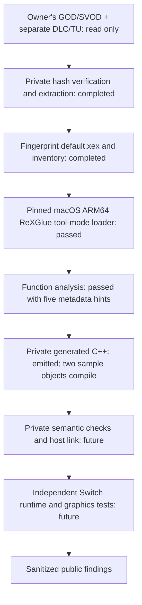

# Proposed architecture — Phase 3

The architecture remains a **proposal**, with intake, host loading and configuration-assisted analysis/generation tested on the supplied game. Full port implementation has not started.

## Binary selection and update boundary

The initial baseline is only `default.xex`, SHA-256 `636a8036b630ae64acb582de4ac7303b8435de808f67e5343f1ddebc74d29456`, Title ID `454108C5`, Media ID `7DD5E14B`. Base DLC/update extractions stay separate. The title update's source-version field matches the base version but it has not been applied or completely validated.

Do not infer modules from extensions: `live.dll` is an XEX executable/header variant at the same preferred base/entry, with a byte-identical stored payload but changed identity/version headers. It was not passed to `--scan-dll` or registered as a second module. Establish actual module-load paths before including it. Any updated/alternate baseline needs new hashes and its own complete analysis results.

## Host and target separation

**VERIFIED host path:** official ReXGlue 0.10.0 macOS ARM64 release at tag commit `f5337cdc947ff6d4c4196737e2c807a48f2a1fc2`. The CLI and a small original tool-mode metadata helper run on the existing Mac; no SDK/dependency build or Linux environment was needed. [Exact commands and artifact fingerprints](research/phase2-commands.md).

**VERIFIED:** configured analysis and private C++ emission complete; two sample partitions compile to Mac objects. [Phase 3 findings and measurement limitations](research/rexglue-analysis.md).

**Not yet validated:** complete CPU semantics, host game link/runtime and Horizon cross build. Keep all local manifests, generated glue, code, decoded images and outputs outside the public checkout. Host codegen tools and target runtime libraries are separate build inputs.

## CPU and runtime contract

The actual image is PE32 PowerPC big-endian, with `.text` and a separate executable BINK section, `.pdata`, TLS, kernel imports and static-library records. Preserve guest register/ABI semantics, endian and VMX128 lane behavior, atomics/reservations, FP status/rounding, indirect dispatch, TLS, callbacks and exception flow. None is proven by parsing or by the presence of a host shim.

The loaded allocation is `0xD70000` at `0x82000000`, entry `0x827F1498`. Header stack is `0x40000`; TLS declares 64 slots and 28 bytes of raw/data. No heap budget or total resident memory is established. The PE declares 14 sections; ReXGlue's analysis view uses 13 and skips `.reloc` beyond the loaded image end. Arbitrary rebasing remains unproven.

All 274 import ordinals resolve and 261 function shims exist, but source review identifies imported exception/unwind and STFS stubs. Determine which paths are exercised before replacing APIs. Required classes include threads/APCs/events/waits, memory/physical mappings, files/content/saves, XAudio/XMA, controller APIs, Vd GPU calls and module loading. [Binary/runtime evidence](research/xbox360-analysis.md).

## Graphics and asset path

**INFERRED first candidate:** adapt a reviewed native PM4/register-to-Vulkan renderer through Mesa/NVK using the architecture of [project8-sw](https://github.com/R-drg/project8-sw/tree/3393f2615deb7e8ac11ce51d2cd0e9defded5669), with the [Simpsons](https://github.com/R-drg/the-simpsons-game-nx/tree/3cb2cdf7fa1665a1f2d653aa7502fe4baa03680f) and [Mercenaries](https://github.com/penettrator/Mercenaries2-NX/tree/65167852496f94b278a82ffea465c51703575f01) integrations as comparisons. No reference was built or run in this phase, and no renderer/SDK patches were imported. Their baselines and game-specific hooks must not be combined blindly.

Actual shader-related evidence is limited to `.fxo` paths in `dfpf` archive indexes and embedded D3D9/XGRAPHC/Vd interfaces. Extract a bounded shader/feature census before deciding how much of the reference SPIR-V path transfers. Test render-target aliasing, resolves, depth/MSAA, queries/predication, CPU readbacks, memexport, texture invalidation and presentation only where demonstrated by game data/traces. None is yet established as a required feature or solved path for this game.

Nineteen archive-header/payload pairs contain names associated with textures, meshes, animations and localization. Do not build a speculative unpacker or replace archive semantics from string evidence alone.

## Audio, middleware, input and persistence

FMOD, Havok, Bink and Lua evidence now exists; their active integration remains untested. All 74 base movies have BIKi magic. The 157 `.fsb`-named banks lack ordinary FSB magic at byte zero, so decoding/transform/codec work is unresolved despite XMA and XAudio imports. SDK XMA support is a foundation, not proof that these banks can be played. Separate movie timing, audio mixing and streaming validation.

Use reviewed libnx pad/audio/filesystem adapters only after defining the game's observed requirements. Keep game resources read-only to the eventual runtime, with isolated saves/settings/caches. XamContent imports and STFS stubs make persistence/container behavior a concrete audit item. No save or controller behavior has been tested.

## Switch and distribution gates

NRO in full application/title takeover mode remains the candidate deployment; no applet/forwarder/key-dependent packaging is added. Prove address aliases, invalidation/protection, fault recovery, FP/SIMD state, synchronization, SD streaming and physical memory budgets on hardware. Stock-clock measurement is required; no overclock assumption or FPS prediction is made.

Only original documentation/checking code is public. Game files, generated source/shaders, decoded payloads, raw logs and full manifests stay private. A future NRO may contain game-derived machine code; no redistribution conclusion or Release is made here. [Third-party boundaries](../THIRD_PARTY_NOTICES.md).
