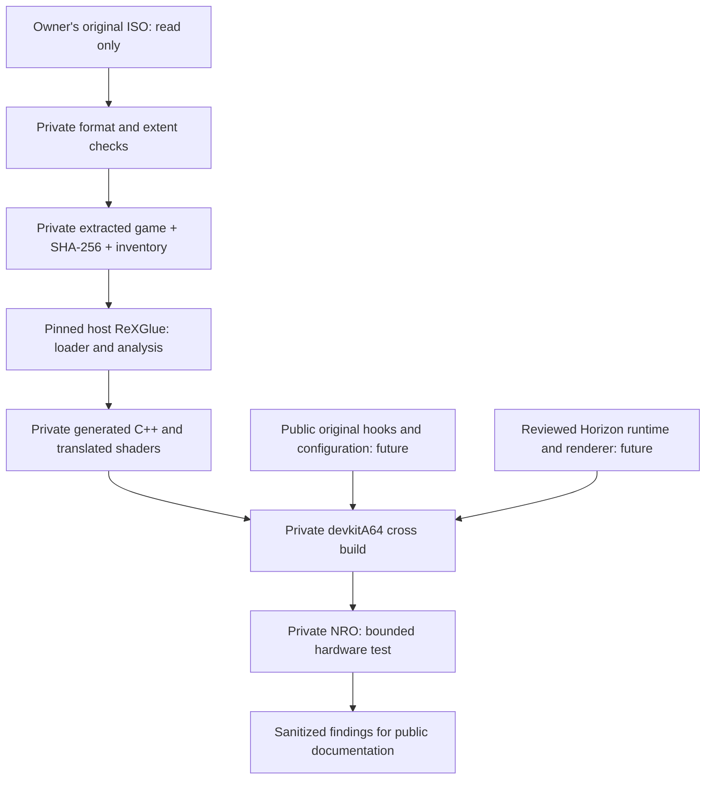

# Proposed architecture

Status: **INFERRED design, not implemented**. Read [the feasibility gates](feasibility.md) before starting any port code.

## ReXGlue first

**VERIFIED:** ReXGlue performs ahead-of-time PowerPC-to-C++ translation and provides an Xenia-derived runtime. Current inspected source exposes XEX/ELF loading, function analysis, generated dispatch, guest memory, kernel objects, threading, input, XMA decoding and graphics subsystems. It is a development toolkit, not a universal game converter.

The [upstream source](https://github.com/rexglue/rexglue-sdk/tree/c94f5ebdcb3c9d1a460ca48e04f9758448f8d518) and [Project 8 integration](https://github.com/R-drg/project8-sw/tree/3393f2615deb7e8ac11ce51d2cd0e9defded5669) are distinct configurations. The upstream CMake platform gate lists Windows, Linux and macOS; Horizon support is supplied by port-specific overlays. Linux ARM64 support does not imply Horizon support.

**Recommendation:** use the pinned v0.10.0 commit `f5337cdc947ff6d4c4196737e2c807a48f2a1fc2` as the initial comparison baseline because Project 8 documents a complete patch series against it. Compare loader/analysis behavior with the inspected upstream commit before selecting a final dependency set. This is not a tested Brütal Legend toolchain. Do not blindly combine Project 8, Simpsons and Mercenaries patches.

## Host/target boundary

The host recompiler reads private inputs and writes outside Git. A target runtime library cannot serve as the host code-generator executable during a cross build. Keep host tools, target libraries, SDK source revisions, manifests, compiler versions, patches, and generated-output hashes distinct in the private build record.

The candidate pipeline uses Git, CMake 3.25+, Ninja, supported Clang/AppleClang for host tools, devkitPro/devkitA64 and libnx for Horizon, and a pinned Mesa/NVK build. Project 8 uses C++23 and documents a Linux/Docker build with additional Clang and glslang tooling. Mesa adds Rust/Meson requirements. Reproduce one baseline before optimizing or changing compilers.

## CPU and runtime contract

- Translate guest instructions and preserve PowerPC integer, floating-point, CR/XER/LR/CTR and VMX128 behavior. Register context is not the host ARM64 ABI.
- Preserve big-endian guest memory behavior on the little-endian host, vector lane rules, unaligned accesses and atomic reservation semantics.
- Resolve guest calls/indirect branches through the generated function map. Enumerate unknown targets and dynamic modules; do not assume `default.xex` is the only executable.
- Implement only the Xbox kernel/XAM imports demonstrated by the binary and traces. Check TLS, events, semaphores, critical sections, file and device behavior, callbacks, guest exceptions and `setjmp`/`longjmp` paths.
- Preserve guest virtual addresses and physical aliases without treating the reserved address span as fully committed RAM. Prove cross-thread and CPU/GPU coherence.
- Validate compiler treatment of concurrent polling loops. Removing volatile accesses or copying another game's wait hooks can create hangs or break timing.

## Graphics decision

**VERIFIED:** Project 8 and the related ports contain an alternative PM4/register reader connected to native Vulkan rendering. Their implementations retain guest GPU semantics selectively and use SDK shader translation, resource untile/conversion, resolves, interrupts and caches. This is substantial GPU compatibility work even when CPU code executes natively.

**INFERRED:** this is a stronger first candidate than running a full Xenos/EDRAM backend on Switch. Its assumptions must be tested against Brütal Legend: render-target aliasing, CPU readback, memexport, predication/queries, MSAA, depth formats/resolves, texture invalidation, shader instructions and presentation timing. No specific one of those features is established for this game yet.

Native renderers may keep resolves only as host images and skip draws while asynchronous pipelines compile. These are observable semantic choices, not universally safe optimizations. No renderer code is imported in this phase. deko3d is a separate candidate requiring its own shader and backend work; it is not a Vulkan drop-in.

## Audio, input, files and saves

Evaluate SDK XMA/FFmpeg decoding and a libnx audio output adapter once the game's actual codecs and APIs are known. Test mixing, movie synchronization, latency and underflow; do not assume it uses a particular middleware. Input can map libnx pads to the guest controller API, including explicit letter/position layout. The game files should be read-only to the runtime; caches, settings and saves use a separate writable SD directory. Xbox save/container semantics and ownership checks remain to be identified.

## Distribution boundary

Only reviewed original public material and appropriately licensed dependencies may enter Git. ISO, XEX, resource inventory details with private paths, raw traces, generated code/shaders and all build products remain outside. A future supported-build table should be keyed by the original XEX SHA-256 and relevant update/module hashes. A build from one edition is not evidence for another edition.
