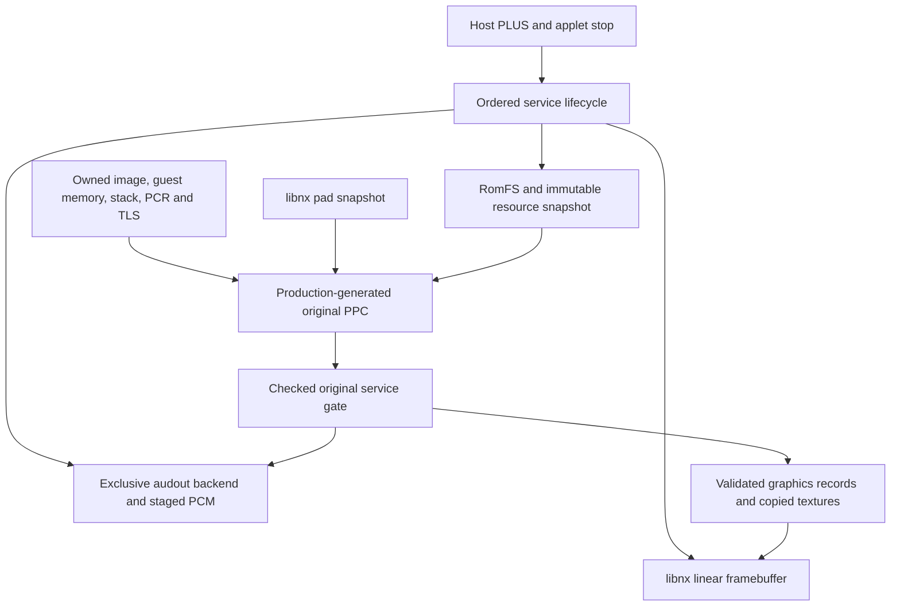

# Horizon synthetic platform services — T66–T85

Date: 2026-11-05. Baseline: `f5649f2715ab7b57f5656a795372d55d5d9cd4af`.
Scope: independently authored PPC, services and assets. **Original game execution NO-GO.**

The new Synthetic Platform Demo integrates production-generated PPC with checked
memory, a CPU renderer, controller snapshots, owned PCM queues and manifest-bound
resources. Host behavior and AArch64 builds are verified as described below.
**Hardware execution of this candidate is UNKNOWN.** Earlier Stage 15 and Native
Image Probe observations do not verify these new platform adapters.

## Implementation and dependency graph



The application serializes platform operations on its main thread. It reuses the
existing `Space`, `GuestThread`, `Scope`, strict `NativeImagePlan` and binding
infrastructure. Existing runtime headers, SDK patches and locks are unchanged.
There is no GPU emulator, Xbox SDK import implementation, XAudio/XMA decoder or
original archive parser in this change.

| Stage | Result and bounded evidence |
| --- | --- |
| T66 | VERIFIED architecture, existing runtime and pinned toolchain audit |
| T67 | VERIFIED host lifecycle, owned names, reverse cleanup and rollback; native return requires hardware |
| T68 | VERIFIED selected existing libnx framebuffer, with CPU RGBA rendering; deko3d not required |
| T69 | BUILD VERIFIED frame acquisition/presentation; actual visible output UNKNOWN |
| T70 | VERIFIED original checked graphics protocol and atomic refusal |
| T71 | VERIFIED synthetic RGBA texture capture, pitch, bounds and staging lifetime |
| T72 | VERIFIED production PPC command formation and host rendering; native presentation UNKNOWN |
| T73 | BUILD VERIFIED libnx standard controller polling; real Joy-Con/Pro behavior UNKNOWN |
| T74 | VERIFIED logical slots, edges, deadzone, Q15 and digital trigger contract |
| T75 | VERIFIED deterministic PPC movement, color action and connection transitions on host |
| T76 | VERIFIED host audio ownership; real audout adapter compiles/links, playback UNKNOWN |
| T77 | VERIFIED start/stop/submit/query and explicit refusal; no volume command |
| T78 | VERIFIED PPC-requested original PCM and host queue; device sound UNKNOWN |
| T79 | VERIFIED manifest-only read/open/close, sandbox and guest OUT checks |
| T80 | VERIFIED size/hash, incremental bounded reads and source-independent snapshot |
| T81 | VERIFIED PPC open/read/use/close against the packaged original resource |
| T82 | VERIFIED bounded host frame scheduling/failure paths; native pacing UNKNOWN |
| T83 | VERIFIED integrated host scene; BUILD VERIFIED interactive NRO |
| T84 | VERIFIED three host profiles and two identical clean AArch64 builds |
| T85 | PARTIAL: isolated package and acceptance protocol ready, hardware acceptance outstanding |

These labels describe engineering scope rather than original-title compatibility.
No T86 work or automatic SD deployment is included.

## Explicit service contracts

`Lifecycle` admits at most 12 services. Registration owns its name and prepares
allocating storage before initialization. Initialization cannot reenter activation;
shutdown requested during initialization also rolls back the pending service.
Cleanup is idempotent, in reverse dependency order, and records cleanup exceptions.
Callbacks must remain valid until cleanup. This is serialized ownership, not a
concurrent service manager.

`Graphics` consumes complete 32-byte-aligned records of eight big-endian u32
words. Commands are BEGIN, CLEAR, COLOR, RECT, UPLOAD, BLIT and PRESENT. Reserved
words, dimensions, sequence, frame monotonicity, alignment, exact allocation
capabilities, current permissions and lifetime are checked before publication.
Malformed submissions publish no pixels, textures or frame number. Pixel bytes
are literal RGBA; packed color words are `0xRRGGBBAA`. Blits are nearest neighbor,
without blending. Up to eight textures and 16 MiB of resident texture bytes are
admitted, with a separate 16 MiB per-submission upload limit. These are original
commands, not Xbox graphics calls.

The demo renders 320×180 and scales by four into a fixed 1280×720 double-buffered
linear libnx framebuffer. There is no dynamic resize. Acquisition/presentation
provides native pacing; no measured FPS or guaranteed latency is claimed. The live
overlay is independently authored. The rectangle, checker texture and frame number
progress through actual generated PPC stores rather than a static status screen.

`Input` supports eight portable logical slots, monotonic frame association, held/
pressed/released bits, connection epochs, an axial deadzone of 4096 and integer
Q15 axes in [-32767,32767]. ZL/ZR are digital 0/65535 triggers. The wire snapshot
is 96 explicitly encoded big-endian bytes, with no host structure-layout ABI.
The NRO uses libnx's default player-1/handheld aggregate as logical identity 1.
Physical controller replacement without an observed disconnected frame is not
identified; automated multi-slot tests do not establish multi-controller native
routing. PLUS is consumed by the host before guest execution.

`AudioService` admits one 48 kHz signed16 little-endian stereo stream with four
owned, 4096-byte-aligned staging slots of at most 65536 bytes each. Validated guest
bytes are copied; no guest pointer is queued. A slot is reused only after its exact
completion. Tokens include owner and generation. Invalid formats, lengths, stale
handles and pointers refuse; backend errors propagate. The deterministic host
backend completes only when explicitly stepped. The libnx adapter exclusively
claims audout, flushes staged bytes and closes its session before storage release,
including stop failures. The demo queues an original 440 Hz, 0.1-second tone on the
first frame and A press. Initialization failure is visibly UNAVAILABLE with its
native error, not simulated successful playback. Submitted and completed counts
are cumulative; queued buffers may be cancelled on stop.

`resources::Service` snapshots at most 16 declared files of 64 KiB each, verifies
sizes and optional SHA-256, then closes native inputs. Reads are incremental, at
most 4096 bytes, with explicit owner/generation handles. Every nonzero requested
OUT span is checked even at EOF, and a failed write cannot advance the cursor.
Host path components use descriptor-relative no-follow opens; traversal, links,
non-regular files and paths outside the manifest refuse. Horizon admits only the
immutable `romfs:/resources` root. This is bounded snapshotting, not general async
streaming or original-game asset access.

The 36-byte `demo.txt` asset has SHA-256
`364ddc10a1f97152a9ffb5a875ee8ffaf01327a2f563ff23b4a9c07ddcd6a541`.
The PPC reads it, returns the byte count and uses its first big-endian word as
rectangle color. A separate host oracle checks the exact expected value/pixels.

## Production PPC and checked integration

The original uncompressed synthetic XEX is built by `fixture.py` using the existing
original container builder. Its SHA-256 is
`1b507e887da3285bdde9288e47053d43fef097a7fadcd491229f15ed2f68ef4a`.
Production ReXGlue v0.10.0 produces **3 functions, 188 instructions, 188 hook sites
and 93 static memory sites**, including seven direct call sites. Generation is
repeated and all generated source fingerprints must match. Independent instruction
decoding is compared to every generated instruction annotation; masks and fixture
identity have separate Python tests. Generated C++ is never manually edited.

Initialization and update call a single original synthetic gate. It is an admitted
internal function, not an Xbox export or a general import escape. Each native
operation validates its module/space, target, arguments and guest capabilities.
All generated memory sites use the existing checked scalar macros; the emitted
body is audited for raw/unsupported paths and receives no unrestricted arena base.
The production prologue, exact boundaries, site map, stop boundary, stack/PCR/TLS
association and scoped leases remain enforced. Untested instructions, typed-vector
signatures and Xbox exception continuations gain no support from this fixture.

Each five-frame normal host run reports: result 5, 19 service entries/completions,
25 generated dispatches, 81 checked generated reads, 332 checked generated writes,
859 hook polls and three submitted PCM buffers. These counters cover generated
accesses only; native bridge transfers perform additional checked operations.
The PPC forms every byte of the seven-record/224-byte render command buffer.
Independent expected coordinates, color transitions, background/checker pixels,
resource bytes, audio queue bytes and full-width r31/r1/LR return invariants are
checked. An additional executed case verifies coordinate mask wraparound.

Audio poll/queue failures preserve their actual native error and mark audio unavailable;
regressions require propagation, poisoning and cleanup. A missing/freshness-invalid
input snapshot, invalid path, wrong PCR/r13, revoked
write permission and injected malformed PRESENT command are refused. The wrong
PCR case checks the guest-entry counter remains unchanged. A post-entry failure
poisons the module and forbids resumed updates; it does not claim guest unwinding.
A trusted native test observer permits command-corruption injection before bridge
validation; it is not reachable through guest arguments or deployed user controls.

## Final regression evidence

All rows below passed separately in **Debug (-O0), Release (-O2), and ASan/UBSan
(-O1, nonrecovering)**. Counts are semantic assertions/expected refusals, not
instruction counts and not independent hardware observations.

| Suite, per profile | Positive | Expected refusals / combined checks |
| --- | ---: | ---: |
| Service lifecycle | 31 | 7 refusals; one deliberately injected cleanup exception recorded |
| Graphics | 10 | 26 refusals |
| Input | 14 | 16 refusals |
| Audio | — | 58 combined assertions, including refusals/native errors |
| Resources | 36 | 48 refusals; 5036 copied bytes |
| Generated integrated PPC | 49 | 11 refusals |
| Existing NativeImagePlan | 75 | 49 refusals; 16384 byte comparisons |
| Existing native module | 97 | 21 refusals; 4 byte comparisons |
| Existing T8/T10 stack window | 5 | 16 refusals |

There are 27 C++ suite/profile runs and two separate Python fixture tests. Final
runs have zero failed assertions, unexpected faults, timeouts or sanitizer findings.
All tracked guest allocations, leases, resource handles and snapshot bytes return
to zero. These counters do not prove absence of all native device/driver leaks.
The stack-window regression is its portable window mode; its older optional
production fixture was not regenerated. Actual production entry checks are run by
the new integrated demo instead.

Development failures are preserved privately: an independent lifecycle review
reproduced a borrowed-name ASan use-after-free and pending-service leak when an
initializer invoked shutdown. Both were corrected with dedicated final regressions.
Early compiler failures and an inspection expectation for inline RomFS wrappers
were corrected, not suppressed. Native warning checks remain `-Werror`.

## Reproduction and build boundary

Use a fresh output directory outside the checkout. `TC` means the existing private
verified ReXGlue staging directory, never a globally modified SDK. `DATA` is a new
external output root, and `ICON` is the previously verified original project icon.

```sh
python3 tests/platform-services/run.py --workdir "$DATA/services"
python3 tests/platform-demo/test_fixture.py
python3 tests/platform-demo/run.py --toolchain "$TC" --workdir "$DATA/host"
python3 tests/native-image-plan/run.py --workdir "$DATA/plan"
python3 tests/native-module/run.py --workdir "$DATA/module"
python3 tests/pre-entry-stack/run.py --workdir "$DATA/stack"
python3 tests/platform-demo/build.py --toolchain "$TC" --host-output "$DATA/host" --icon "$ICON" --workdir "$DATA/native"
```

The CLI fingerprint is
`6f40ec768bba9ea985719f6df543c5e0bd099b19ceaec88aee9f9c7f7e6cc15c`;
SDK revision `f5337cdc947ff6d4c4196737e2c807a48f2a1fc2`. The existing pinned
container is `devkitpro/devkita64@sha256:1fc388c3a0d34bd2045a6dadcb1020e069d5f876a187fd705de14b4440c00282`,
linux/arm64, devkitA64 r29.2/GCC 15.2.0, libnx 4.12.0 and switch-tools 1.13.1.
No image pulling, global SDK changes, title inputs or network use occurs in build
containers. Each compile/link/inspection or host test has an external monotonic
30-second watchdog. Containers have bounded memory, CPU and processes and are
removed by their unique task-owned name. Docker-client RSS is not compiler VM RSS.

Two fresh output trees must produce identical selected objects, ELF and NRO.
Inspection checks AArch64 ELF64 PIE, separate non-W+X loads, no DT_NEEDED or
unresolved strong symbols, actual platform symbols, no prohibited raw-memory or
network APIs, NACP identity, embedded RomFS path/hash, segment-by-segment NRO/ELF
byte correspondence (excluding the reserved NRO header), bounds/padding/BSS and
absence of local sensitive paths. Diagnostic path sanitization and removal of upstream build debug sections change no
executable bytes. The build manifest and SHA256SUMS accompany the separate ZIP.

CI runs portable platform-service profiles and the original encoding tests in a
separate bounded job. It does not download the private staged CLI or perform
production code generation/cross-compilation; those are local verified checks.

## Build receipt and measured bounds

Two clean builds produced the same 774210-byte NRO:
`8e4268ba72d8f10ba3a94f55f17a4361ecde01fcfeac01f7355974eb4278ebba`.
The ZIP SHA-256 is
`e768cfe77a66828ea23f47b68bd39a3ca7ae2aaee62f3c5115ec0005fc54c911`.
A separate byte comparison confirms both final ELF executable segments match the
original linked ELF before diagnostic sanitization/debug stripping. ZIP integrity
and its contained NRO bytes are independently checked.

The five-service/three-profile run took 27.330 seconds including compilation;
its child executions took 10.199 seconds in total, with peak child RSS 39305216
bytes. The final integrated production-generation/host run took 17.617 seconds,
with maximum executed-test RSS 66355200 bytes. Two native builds plus inspection
took 25.764 seconds of recorded watchdog intervals; maximum Docker-client RSS was
26771456 bytes, **not** the compiler VM peak. Each container was capped at 1 GiB.
These local host/build measurements are not Switch performance measurements.
All final watchdog records have exit 0 and no timeout.

## Native limitations and acceptance

BUILD VERIFIED is distinct from hardware execution. Selected libnx framebuffer
and input failures call `diagAbortWithResult`; C++ rollback and the final screen
are not guaranteed on these native-abort paths. Ordinary C++ service failures do
roll back. No global memory-protection bypass, speculative exception dispatch or
fake Xbox success path is introduced.

New isolated application path:
`switch/brutal-nx-platform-demo/brutal-nx-platform-demo.nro`.
Package: `brutal-nx-platform-demo-t85.zip`. No existing NRO is overwritten and no
USB/SD write is performed. [Hardware acceptance checklist](synthetic-platform-hardware-acceptance.md).

Historical **G4 BLOCKED / G5 UNKNOWN / G8 BLOCKED** and native **N-G4 BLOCKED /
N-G5 PARTIAL / N-G8 BLOCKED** remain unchanged. Platform progress does not resolve
original image RW authority/lifetime, virtual tail, page gaps, variable providers,
unknown continuation paths or Xbox exception semantics. The sole next practical
platform action is external observation of this candidate, including normal PLUS
return and its actual cleanup counters. No further stage is presumed.

Primary API references at the checked libnx revision:
[framebuffer](https://github.com/switchbrew/libnx/blob/7644c9b26099aa2d2145bc72a21ee24190e92085/nx/include/switch/display/framebuffer.h),
[pad](https://github.com/switchbrew/libnx/blob/7644c9b26099aa2d2145bc72a21ee24190e92085/nx/include/switch/runtime/pad.h),
[audout](https://github.com/switchbrew/libnx/blob/7644c9b26099aa2d2145bc72a21ee24190e92085/nx/source/services/audout.c),
[console initialization](https://github.com/switchbrew/libnx/blob/7644c9b26099aa2d2145bc72a21ee24190e92085/nx/source/runtime/devices/console.c).
