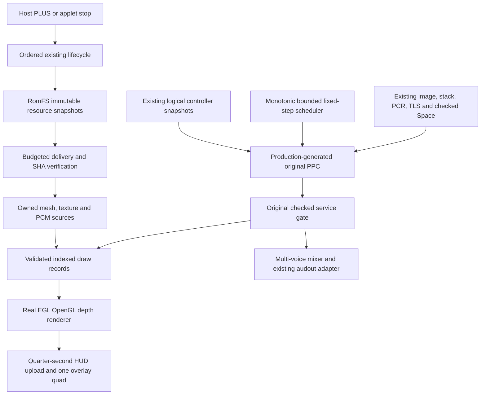

# Synthetic 3D platform runtime — T86–T105

2026-11-05. Baseline `dca241ed9dc6bc3b9c1277ffc040f2f4b4020f91`.
**Original game execution NO-GO. New V2 hardware execution UNKNOWN.**

T85 is USER-CONFIRMED HARDWARE VERIFIED for observed graphics, controller
interaction, audio, lifecycle and normal exit. Original photographs were not
available for independent inspection; exact screen counters, zero-resource screen
values and FPS are UNKNOWN. Its original NRO SHA-256 remains
`8e4268ba72d8f10ba3a94f55f17a4361ecde01fcfeac01f7355974eb4278ebba`.
Its source, package and previous checkpoint are preserved unchanged.

## Service graph and implementation scope



The main thread serializes graphics, input, streaming and guest updates. Mixer
calls have their own mutex. Existing T85 services, image admission, stack/context
checks and SDK locks are reused unchanged. No speculative Xbox export or title
mapping is introduced. The new scene is four original textured cubes, including
one controlled object and an orbiting child transform.

| Stages | Completed engineering scope | Remaining boundary |
| --- | --- | --- |
| T86 | Exact T85 identity and user report locked; regression checklist retained | Hardware numerical counters uninspected |
| T87 | Explicit service graph, host/guest handle and capability boundaries | General Xbox runtime unsupported |
| T88–T90 | Real EGL/OpenGL adapter, indexed vertex/index buffers, depth24, matrices, owned RGBA uploads | New GPU behavior requires hardware |
| T91–T93 | Four objects, hierarchy composition, perspective camera, deterministic rotation/scale, both sticks and action edges | Native disconnect/device routing needs observation |
| T94 | Monotonic measured intervals, fixed simulation step, bounded catchup and explicit dropped-step counts | Actual Switch pacing/FPS UNKNOWN |
| T95–T96 | Eight-voice PCM mixer, Q15 volume, loops/one-shot, bounded queue, cancellation and underflow reporting | Native new mixer playback UNKNOWN |
| T97 | Incremental checked guest delivery plus incremental SHA verification and cancellation | Source files remain bounded immutable snapshots |
| T98 | Measured payload budgets and generation-keyed GPU mesh/texture reuse | Driver/swapchain memory UNKNOWN; no general-purpose eviction manager |
| T99 | Production PPC updates scene/camera/animation, emits full draw records, requests resources/audio and honors stop | Synthetic ABI only |
| T100 | Selected scalar/register/endian/ownership audit below | Full Xbox ABI/title behavior unverified |
| T101–T102 | Host failure containment, rollback, compact real-counter HUD and exit summary | Native GPU error/abort paths not executed |
| T103–T104 | Integrated original host demo, three test profiles, reproducible AArch64/NRO candidate | Native visuals/sound/input/exit acceptance outstanding |
| T105 | Isolated V2 package and acceptance protocol prepared | PARTIAL: HARDWARE EXECUTION UNKNOWN |

No stage beyond T105 is started and no SD deployment occurs in this cycle.

## Rendering, scene and input

`Scene3D` admits explicit immutable copied vertex/index/texture resources. Vertex
format1 is five BE float32 values x/y/z/u/v, stride20; index format1 is BEu16
triangle lists. Format, finite values, indices, dimensions, pitch, alignment, exact
allocation ownership, commitment and current permissions are checked. Guest bytes
are converted to host numeric layout before GPU upload. Unsupported tiled/swizzled
Xbox formats refuse.

The original command ABI uses 32-byte records of eight BEu32 words: BEGIN,
CAMERA, BIND_MESH, BIND_TEXTURE, MODEL, DRAW and END. Resource identities carry
owner64/slot32/generation32. Matrices are exact64-byte BEfloat32 column-major
spans supplied with checked capabilities. Each draw needs valid explicit geometry,
texture and a fresh model matrix. Invalid sequence, missing resources, stale
handles, ranges and formats refuse transactionally without publishing a frame.
A conservative transformed AABB clip test marks visibility; it is not occlusion
culling or complete arbitrary-geometry clipping.

Native `Scene3DGl` uses the already installed Mesa/nouveau EGL OpenGL4.3 core path,
original shaders, perspective/depth testing and indexed draws. deko3d is absent
from this pinned environment and was not installed. It uploads each resource once
per owner/slot/generation and repeats the last immutable frame between simulation
steps. No software fallback is used. Culling and blending are disabled for scene
geometry; linear RGBA textures use nearest sampling. The independent diagnostic
HUD is one alpha-blended quad, with its CPU bitmap/texture updated at most4Hz.
The libnx console is created only after GL/EGL teardown.

The left stick moves the first cube in a bounded wrapping square. The right
stick changes camera yaw/pitch; pitch is clamped. A toggles object scale and plays
an original action voice. B toggles ambient playback; X/Y set ambient volume.
Existing deadzone/Q15 normalization, button edges and observed reconnect epochs
are retained. The native input identity is logical player1/handheld aggregation,
not physical controller serial identity. PLUS is checked by the host before any
new guest update and cannot be intercepted by PPC.

## PCM and resources

`Mixer` owns at most eight copied 48kHz stereo signed16 little-endian sources,
<=65536 bytes each. Gains are integer Q15 [0,32768]; samples accumulate in int64,
round toward zero once and saturate once. One-shot/loop cursors commit only after
successful queue submission. Full queues and failures do not advance cursors.
Each pump submits at most2048 frames without waiting; the demo uses800 and a
bounded two-quantum cold/resume fill. Existing audout staging and four-slot queue
ownership are reused. Stopping a voice cancels future contributions; already mixed
queued audio has a bounded tail. Closing the mixer cancels the entire queue before
freeing sources/staging, including native-error cleanup.

An underflow means an empty observed backlog with active voices after the first
successful submission; it is not a direct measurement of audible discontinuity.
The deterministic stop/resume host scenario records **one** such event per run;
it is reported, not suppressed. Audio initialization failure remains visibly
UNAVAILABLE with its code while graphics can continue. Poll/queue/close errors
retain their actual native code and stop or poison execution as appropriate.

Four original generated assets total39240 bytes: scene584, checker256 and two
19200-byte integer triangle-wave PCM sources. No copyrighted game assets are used.
`Stream` reuses T85 manifest-bound snapshots and performs two bounded phases:
delivery then verification from a sealed read-only guest output. Each demo job
consumes at most128 asset bytes per simulation step, with at most four jobs;
SHA finalization adds at most two fixed64-byte compression blocks. A transferred
byte count equal to file size does not mean ready until verification completes.
Only fully verified outputs transfer ownership; the caller releases them after
mesh/texture/PCM capture. Source shutdown, malformed identity, cancellation,
invalid destinations and budget exhaustion roll back. External host pins must be
retired before transactional stream shutdown/destruction.

Snapshotting limits still apply: <=16 files, <=64KiB each, read-only RomFS root.
This is bounded incremental delivery, not large-file asynchronous disk streaming.
The scene cache shares one mesh/texture across four draws instead of introducing
another general resource manager. Scene CPU/GPU payload caps are2MiB mesh and8MiB
textures each; mixer sources cap512KiB and staging8192 bytes. This demo uses552
mesh bytes,256 texture bytes,38400 PCM source bytes,49152 initially charged stream
bytes,16384 shared guest bytes and a640×90×4 HUD bitmap/texture. Driver allocations,
swapchain memory, image/stack overhead and native RSS are additional; these
payload counts are not a total Switch memory measurement. Standard libnx heap
selection is used, not T85's fixed32MiB assumption.

## PPC, timing and ABI evidence

Original synthetic XEX SHA-256:
`0daa13ce9b2ecf31cb9e9e74b633606f88c9e203ab8b73cf6e1f74047d318016`.
Production ReXGlue v0.10.0 emits **3 functions,281 instructions,281 hooks and147
static memory sites**. Generation is repeated with matching hashes; independent
instruction decoding matches every generated annotation. Generated C++ is never
edited. All emitted accesses use existing checked macros, with strict control,
module, stack/PCR/TLS and scoped admission. There are no Xbox function imports.

PPC performs bounded integer position/camera/animation updates and writes every
byte of the416-byte indexed command buffer. A declared native math service derives
floating-point matrices from that state; this does not claim PPC trig/matrix
instruction implementation. Native services own resource jobs and audio tokens;
these are not raw host pointers visible to PPC. The selected contract uses32-bit
guest addresses and scalar r3–r6 arguments/results, verifies r1/LR and full64-bit
r31 preservation, and requires the current GuestThread PCR/TLS identity. r2/TOC,
complete FPR/vector ABI, arbitrary callbacks, guest exceptions and unwind gain no
new support. Existing typed-vector signature denial remains.

Simulation uses16666667ns steps and at most four catchup updates per displayed
frame; excess complete steps are counted and discarded, preserving fractional
phase. The live HUD shows the last completed render sample, updated at most4Hz.
CPU update, submission-plus-present and frame intervals are measured from
one monotonic clock. Nominal missed deadlines and jitter are scheduler metrics,
not observed GPU dropped frames. No measured Switch FPS or timing claim is made.

The340-tick normal host scenario independently checks positions, four draw
snapshots, mesh/texture contents, action edges, reconnect, resource bytes, registers
and cleanup. It records result340,1324 submitted logical draws,1353 service
entries/completions,1694 generated dispatches,8082 checked generated reads,38169
writes and90567 hook polls;38 PCM buffers submitted,36 completed before shutdown,
with the remaining queue cancelled on close. These generated-access counters
exclude additional checked bridge transfers and are not hardware targets.

## Tests and refusals

Every following C++ suite ran separately in Debug, Release and ASan/UBSan:

| Suite | Recorded semantic checks | Expected refusals | Separate comparisons |
| --- | ---: | ---: | ---: |
| New 3D scene admission/math | 20 | 41 | 16 bytes |
| New mixer | 55 | 26 | 10 PCM oracle buffers (91 total) |
| New streaming | 185 | 40 | 78995 bytes;142 budgeted steps in principal fixture |
| New timing | 25 | 17 | Independent irregular timestamp arithmetic |
| New production PPC integration | 42 | 11 | Exact scene state/resource/register assertions |
| Preserved T85 PPC | 49 | 11 | Existing pixel/PCM expectations |
| Existing NativeImagePlan | 75 | 49 | 16384 bytes |
| Existing native module | 97 | 21 | 4 bytes |
| Existing guest memory foundation | 20 | — | Existing checked allocation/thread contracts |

Streaming/timing JSON reports225/42 total assertions respectively, including
40/17 expected-fault-category assertions. The table separates those from the
185/25 other semantic assertions; these counts must not be added twice.

The five T85 service suites also pass unchanged in all three profiles. There are
42 C++ suite/profile executions, three original PPC/asset Python tests and eight
strict sanitizer Python tests. Final runs have zero failed assertions, unexpected
faults, timeouts or sanitizer findings. All tracked guest allocations, leases,
stream jobs, resource handles and snapshots return to zero. Native driver leaks
cannot be excluded by host counters. Old T85 NROs are not rebuilt or overwritten.

Failure injection covers invalid commands, missing/stale resources and pointers,
source shutdown during load, wrong r13 before entry, revoked permissions, audio
init/poll/queue failures, queue capacity and controlled stop inside generated
execution. Failed guest updates cannot resume as if an Xbox exception unwound.
Native EGL/shader/upload/present failures have explicit error/cleanup paths, but
those device failure paths are BUILD VERIFIED only. Existing libnx fatal-abort
paths may bypass a final screen/normal C++ cleanup; no speculative recovery exists.

## Reproduction, dependencies and package

Use fresh external output directories. `TC` is the preserved verified private CLI
staging, and `ICON` is the original project icon. No title input is consumed.

```sh
python3 tests/platform-v2/test_fixture.py
python3 tests/platform-v2/test_sanitize.py
python3 tests/platform-v2/components.py --workdir "$DATA/components"
python3 tests/platform-v2/run.py --toolchain "$TC" --workdir "$DATA/host"
python3 tests/platform-v2/licenses.py --cache "$DATA/dependencies" --output "$DATA/notices.txt"
python3 tests/platform-v2/build.py --toolchain "$TC" --host-output "$DATA/host" --icon "$ICON" --notices "$DATA/notices.txt" --workdir "$DATA/native"
```

The original container/toolchain lock is unchanged. New graphics headers/libraries
and package versions are pinned in `tests/platform-v2/graphics-lock.json`:
Mesa20.1.0-5, GLAD0.1.27-1 and libdrm_nouveau1.0.1-2. Package source recipes identify
Mesa's upstream archive as20.1.0-rc3 plus Switch patches. GLM is not linked.
Attribution generation verifies exact upstream archive/license hashes, reads only
notices and never executes or extracts source paths. The inventory is deliberately
broader than the linked Mesa subset; inclusion of a notice is not a claim that its
component is linked. Runtime/BSD/SIMDe/libnx notices also accompany the package.

Build containers are offline, read-only except fresh output, and capped at1GiB,
2CPU and128 processes. Every compile, link, inspection and dangerous child test
has an external30-second watchdog. Two clean builds must match selected objects,
ELF and NRO exactly. Inspection verifies AArch64 PIE, non-W+X loads, no unresolved
strong symbols/DT_NEEDED, actual native symbols, complete RomFS identities, NRO/ELF
load-byte correspondence and private-path exclusion. The separate V2 diagnostic
sanitizer admits exactly three observed pinned-newlib RO strings; all other
loaded paths refuse. Executable bytes and layout are unchanged by sanitization.
Debug sections from prebuilt dependencies are removed from the final ELF.

CI checks portable new components and original Python fixtures in a separate job.
Production generation/cross-builds remain explicit local checks using the staged
CLI and pinned image; CI does not fetch private tooling or game inputs.

Package: `brutal-nx-platform-demo-v2-t105.zip`; isolated destination:
`switch/brutal-nx-platform-demo-v2/brutal-nx-platform-demo-v2.nro`.
[Device acceptance checklist](platform-v2-hardware-acceptance.md).
T105 is a BUILD VERIFIED acceptance candidate, with HARDWARE EXECUTION UNKNOWN.

Final receipt: both clean builds produced the same6478326-byte NRO,
SHA-256 `98b44442310c554afa360573e42444dce6d83a1d39e8a3b9d659498c14c3ac3d`.
ZIP SHA-256:
`602039d6d1498fee0bc0d11b824413f4a25729436fdd219048f8dbf43d279af1`.
A separate comparison confirms both ELF executable loads match their pre-sanitizer
linked counterparts. The six-file ZIP, current notices and all embedded resources
are independently checked.

Final four-component/three-profile testing took18.885s including compilation,
with maximum executed-test RSS51036160 bytes. Final production generation and
three integrated host profiles took19.584s, maximum executed-test RSS93896704
bytes. Two native builds/checks took31.516s across recorded watchdog intervals;
maximum Docker-client RSS26951680 bytes is not the VM compiler peak. Every native
child stayed within its30s watchdog and1GiB container cap. These are host/build
measurements, not Switch performance or native memory observations.

Historical **G4 BLOCKED/G5 UNKNOWN/G8 BLOCKED** and native **N-G4 BLOCKED/
N-G5 PARTIAL/N-G8 BLOCKED** remain unchanged. No qualified external Xbox startup
trace, original image RW authority/lifetime or exception continuation proof was
obtained. The next practical step is one separately authorized hardware deployment
and observation of V2, not original-title execution or automatic T106 work.

Primary implementation references:
[official Switch OpenGL example](https://github.com/switchbrew/switch-examples/tree/669786898205b7beb25ff1731e72982e6d0397d3/graphics/opengl/simple_triangle),
[Mesa package recipe](https://github.com/devkitPro/pacman-packages/blob/master/switch/mesa/PKGBUILD),
[GLAD recipe](https://github.com/devkitPro/pacman-packages/blob/master/switch/glad/PKGBUILD),
[libdrm_nouveau recipe](https://github.com/devkitPro/pacman-packages/blob/master/switch/libdrm_nouveau/PKGBUILD).
The actual local archive/header/library hashes, rather than moving recipe URLs,
are the reproducibility authority.
