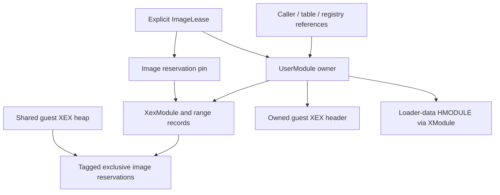

# Image ownership and runtime contracts — Phase 12 recovery

Assessment: **2026-10-22**. Baseline `v0.0.11-synthetic-execution`, commit `090594ab67d9b073691a23f21b2b0c6176e2a6e2`. **VERIFIED: Phase 12 PASS for the bounded original synthetic macOS scope. Private game-code execution remains NO-GO.** The three original real-SDK failure assertions now pass unchanged in Debug, Release and ASan/UBSan. This is not a game boot, Switch result or complete XEX/ABI certification.

## Preservation and reproducible SDK

Recovery preserves the fifteen unfinished Phase 12 files and privately saves their original contents/hashes. The complete original `tests/image-runtime/xex.cpp`, including the three formerly failing assertions, is byte-identical. Existing synthetic image, ABI, import and TLS assertions remain intact; no expected signal is weakened.

The original private default.xex SHA-256 remains `636a8036b630ae64acb582de4ac7303b8435de808f67e5343f1ddebc74d29456`. All 1,455 original XEX/config/generated fingerprints and 299 extracted-file hashes match. No proprietary code is executed, compiled or regenerated, and no title update is applied. Original game assets, generated C++, configuration, installed SDK and the prior isolated SDK remain unchanged. Generated fixture output and diagnostics remain private.

ReXGlue v0.10.0, `f5337cdc947ff6d4c4196737e2c807a48f2a1fc2`, is rebuilt in a new private workspace using [image-runtime-lock.json](../../tools/sdk/image-runtime-lock.json): the sixteen unchanged historical patches plus [patch 0017](../../patches/rexglue-sdk/0017-xex-transaction-ownership.patch). The builder verifies pristine source plus ordered patches, 22 submodules and pinned dependencies before compiling. Matching runtime/headers/codegen/CLI are used per profile. No global installation occurs.

The final fixture build explicitly uses `--interposable-runtime` (default off), enabling macOS ld `-interposable`. Ordinary internal C++ binding prevented the first allocator interposer from intercepting SDK calls. This isolated test linkage makes two child-local return-zero/bad_alloc injections observable; each asserts one interception and successfully disarms/retries. The original failed injection oracles remain private. All final core suites use the same matching profile SDK; ordinary children scrub DYLD overrides. The injected children still run the actual SDK loader/rollback implementation, and never substitute a success implementation. No protection bypass or global linker/environment change is introduced. Normal-linkage initial ownership successes remain separate draft evidence. Build results record the option.

## Root causes and corrections

| Confirmed original defect | Root cause | Correction and unchanged original oracle |
| --- | --- | --- |
| A: foreign allocation lost on XEX load | ReadImage reset the entire containing shared heap before each key attempt | No heap Reset. XexModule records only its exclusive tagged reservations. Foreign reservation survival and owned release pass |
| B: failed load retained guest pages | loaded_ was set before completion; retries/failure returns had no resource transaction; destructor did no cleanup | Retry releases only its own previous attempt; failed Load/LoadContinue unwind owned mappings and metadata; destructor owns idempotent cleanup. Invalid-PE Load false leaves no pages |
| C: guest XEX header retained after final UserModule release | LoadXexContinue allocated guest_xex_header_; no responsible destructor released it; processor_module_ was also a raw unmanaged owner | UserModule tags/owns the guest header, frees it once at final legitimate destruction and deletes processor metadata; failed file-load stages roll back immediately. Header and HMODULE are free after final refs |

The first sixteen-patch Phase 12 run had three genuine exit-1 failures per profile. They were not expected-negative passes. The source, initial results, drafts and diagnostics remain private. Recovery preserves the exact original assertions and fixes the runtime to satisfy them.

## Actual ownership graph and invariants



**VERIFIED invariants:**

- A new XEX-only AllocFixedOwned operation holds the SDK global-before-heap locks across empty-range validation, reserve, ownership tagging, commit and failure rollback. Existing allocation/XamFree APIs are unchanged. The legacy combined reserve|commit path does not itself establish collision exclusivity, so it is not used to acquire loader ownership.
- Each XexModule records successful allocations under its lifecycle mutex. Failure to record releases that same owner-tagged allocation. ReleaseImages uses ReleaseOwned, in reverse acquisition order, and never resets a shared heap or frees another owner. A failed reservation cannot destroy an existing image at the same address.
- Load and continuation publish success only after their stages succeed. Failure rolls back owned mappings and header/PE/import/binary metadata. Retry cannot accumulate old reservations. Length/count/extent checks bound the exercised header, compression, PE, import and protection failure paths. Unsupported variable/unknown thunk imports refuse success; known function-import metadata remains recognized without claiming ABI support.
- UserModule owns its processor object. File-load failure removes partial header/processor resources and leaves the caller-owned UserModule/HMODULE for legitimate final release or a valid retry. Header allocation uses the existing NO_MEMORY path for return-zero or bad_alloc; no Xbox status is invented.
- Successful explicit image unload clears entry/section availability but keeps header metadata/HMODULE alive for remaining legitimate UserModule references. Final destruction releases the tagged header once, destroys processor metadata, then XModule releases loader data. Stale high-level header/section/procedure queries refuse access; raw borrowed pointers are not independently safe after unload.
- An explicit host UserModule::ImageLease both retains UserModule and pins its image. Unload while leased returns the existing UNSUCCESSFUL status and closes new admission. The final lease release only removes the pin; later explicit unload or legitimate final destruction reclaims resources. No reference counter is guessed, live object forcibly deleted or thread cancelled. The active-reference test removes registry/table/caller owners while the lease keeps resources live, then proves final reclamation.

Caller/table/registry object references and image-execution pins are distinct. A plain object_ref preserves metadata/object lifetime but does not authorize image execution across explicit unload. Raw headers, section spans and callbacks require an owner and lease spanning their use. Existing title dispatch/XThread paths do **not** automatically acquire these leases; there is no certified title stop/unload protocol. Reset/Restore/MMIO mutation require quiescence. A stolen owner tag or impossible live lease at final destruction fails visibly rather than forcing cleanup.

Patch-growth reservations use the same owner record, and failed patch application on an unpublished target rolls it back. Published/leased targets are refused before mutation. Delta parsing/application compatibility, valid patch success, ELF loading, arbitrary rebasing and every possible host syscall failure remain unverified; no TU or proprietary image is used to certify them.

## Actual loader regression scope

The original [XEX fixture](../../tests/image-runtime/xex-fixture.h) authors an unencrypted XEX2/minimal PE32 image with three code/RO/RW descriptors. [Original tests](../../tests/image-runtime/xex.cpp) validate real Load/LoadContinue/Unload without dispatching image instructions. [Recovery tests](../../tests/image-runtime/ownership.cpp) use the real SDK, not a mock loader:

| Group | Evidence |
| --- | --- |
| collision | Two non-overlapping images and a foreign tagged reservation coexist; overlapping image refuses without modifying survivors; one unload does not affect the others |
| rollback | Ten length-consistent or deliberately bounded failures: PE magic, NT signature, section extent, basic input truncation, normal hash, unknown variable import, protection extent, security header span, normal post-allocation decode refusal, unknown thunk import. Each restores exact XEX free-page count, clears metadata, supports clean reload |
| basic-compression | Original single-block unencrypted basic-compression load/protect/unload succeeds |
| known-function-import | Real resolver ordinal for KeTlsGetValue populates original value/thunk metadata; this does not invoke or certify its ABI |
| reload | Sixteen load/continue/continue/unload/unload cycles on the same XexModule; no accumulated sections or retained pages |
| metadata | Sixteen UserModules; copied refs keep header/HMODULE alive after image unload; high-level stale queries refuse; final refs reclaim both and restore exact heap counts |
| active-references | Worker holds real image lease; unload refuses and closes admission; registry/table/caller removal does not reclaim live image/header; final lease destruction does |
| concurrent-images | Six host workers complete 48 scheduled independent real-loader cycles on the shared heap; exact free-page count restored after join |
| header-failure-zero / throw | Two child-local actual SDK allocator injections; exactly one interception each, existing NO_MEMORY status, no partial image/header/processor/registry publication, disarmed successful retry and final cleanup |

These are selected deterministic outcomes, not exhaustive concurrency/race/resource-leak proofs. Valid normal/LZX decompression and encrypted XEX compatibility are not certified by its failure fixtures. No synthetic result establishes full external XEX parsing or game compatibility.

The separate custom loader still uses the actual raw-test generation pipeline for the original 144-byte/36-instruction/nine-function PPC fixture. Its unchanged generated TU SHA-256 is `7ccd9893b5e2e898e16080e2740a70ec8dc6a0b870cf95aed8641f2936f88d9e`. This is not production XEX-driven code generation or GapFill. Checked-memory tests remain opt-in: 4-KiB guest pages can share a 16-KiB host page, so host protection cannot isolate raw sub-page slack. There is no general execute bit, native C++ sandbox or global guest isolation.

## Custom loader, TLS and call contracts

**VERIFIED:** copied image handles, busy unload/new-admission refusal, stale token rejection after address reuse, an ABS32BE relocation at the last writable word with a target at the last RO byte, and 32 repeated create/close cycles. Injected failures after mapping and after import resolution reclaim the known reservation. Missing imports, duplicate imports and unsupported signatures reject with rollback. Existing Phase 11 malformed/alignment/overlap/entry/gap/protection tests rerun unchanged.

A gated host worker retains its lease and performs 100 generated checked loads after the main thread requests unload. New admission is rejected; the old caller completes against still-live pages, then close reclaims them. This proves selected ordered outcomes, not exhaustive race freedom. ASan/UBSan are not race detectors.

**VERIFIED:** two actual SDK XThreads each attach two custom module instances with different original TLS templates. Each block is explicitly zeroed before copying the template. Module block addresses are stored in reserved dynamic SDK slots 1/2; real KeTlsGetValue/SetValue are called with a bound PPC context. PCR/r13/default TLS are SDK-created. Four module blocks are distinct, per-thread writes remain isolated, active unload returns busy, TLS slots clear before block release, join precedes final PCR/TLS reclamation, and both thread destructors run. The module helper must construct/destroy on the same bound thread, before Exit, with caller-reserved empty slots; it does not discover or reserve slots for arbitrary titles.

Three deterministic thread-local initialization injections test rollback after allocation, after template copy, and after slot binding. Each thrown host error leaves the block free and slot zero. These are partial-init failure fixtures, not proof of every SDK allocator-OOM path. Prior allocation/factory failure regressions remain unchanged. Module header-driven TLS, multi-title/fiber/APC integration and a general title stop protocol remain **UNKNOWN/BLOCKED**. Setting an executable module would also start the SDK dispatch worker; that broader path is not silently substituted for these fixtures.

## Import contracts and ABI

[The complete 33-entry contract matrix](../../tests/image-runtime/import-contracts.json) records arguments, returns, errors, output initialization, ownership, thread context, evidence and status for every previously identified direct dependency. [The source auditor](../../tests/image-runtime/audit.py) cross-checks the historical dependency-name set and one real SDK registration per symbol, and saves source hashes privately. This proves registration provenance, not conformance or checked import admission. No game body or private address is copied into the matrix.

**27 PARTIAL, six BLOCKED**, considering each whole import. **23** have at least one selected executable observation in the rerun/new fixtures; **ten** real exports are called in the new import group, with one overlap (RtlInitAnsiString) with earlier selected entry-import tests. A VERIFIED narrow result must not be read as a fully verified import. Six source-reviewed blocking entries and four other source-only partial entries are not invoked merely to advance execution.

| Import | Whole-contract status | Selected evidence / limit |
| --- | --- | --- |
| DbgPrint | PARTIAL | Phase 9 null call |
| ExGetXConfigSetting | PARTIAL | Phase 12 invalid category/setting, short buffer, secured AV-region value |
| HalReturnToFirmware | BLOCKED | source only; not invoked |
| KeBugCheck | BLOCKED | source only; not invoked |
| KeBugCheckEx | BLOCKED | source only; not invoked |
| KeDelayExecutionThread | PARTIAL | source only; no new blocking/APC fixture |
| KeGetCurrentProcessType | PARTIAL | source only; not invoked in Phase 12 |
| KeQueryPerformanceFrequency | PARTIAL | Phase 12 positive result; exact Xbox frequency/width unverified |
| KeTlsAlloc | PARTIAL | Phase 6 real slot lifecycle/exhaustion rerun |
| KeTlsFree | PARTIAL | Phase 6 invalid/repeated/valid free rerun |
| KeTlsGetValue | PARTIAL | Phase 6 bounds/isolation and Phase 12 module-block lookup |
| KeTlsSetValue | PARTIAL | Phase 6 bounds plus Phase 12 binding, clear and rollback |
| NtAllocateVirtualMemory | PARTIAL | Phase 6 allocation lifecycle/errors rerun |
| NtClose | PARTIAL | Phase 9 valid/double/concurrent close rerun |
| NtCreateEvent | PARTIAL | Phase 9 unnamed event/close rerun |
| NtFreeVirtualMemory | PARTIAL | Phase 6 lifecycle/errors rerun |
| NtQueryVirtualMemory | PARTIAL | Phase 9 error sentinels and RW region rerun |
| NtWaitForSingleObjectEx | PARTIAL | Phase 9 invalid-handle refusal rerun; no unbounded wait |
| RtlCompareMemoryUlong | PARTIAL | Phase 12 independent BE words including mismatch and alignment; Xbox return convention unverified |
| RtlEnterCriticalSection | PARTIAL | source only; generated atomics remain rejected |
| RtlImageXexHeaderField | PARTIAL | Phase 12 original header immediate and missing key; malformed input untested |
| RtlInitAnsiString | PARTIAL | Phase 9 null and Phase 12 short owned string; unbounded input BLOCKED |
| RtlInitializeCriticalSection | PARTIAL | Phase 12 selected initialized fields |
| RtlInitializeCriticalSectionAndSpinCount | PARTIAL | Phase 12 spin=257; extreme range remains unsupported/unfixed |
| RtlLeaveCriticalSection | PARTIAL | source only; contention/wrong-owner unverified |
| RtlNtStatusToDosError | PARTIAL | Phase 12 success, INVALID_HANDLE and unknown status |
| RtlRaiseException | BLOCKED | source only for this import; not invoked |
| XGetAVPack | PARTIAL | Phase 12 constant; hardware/user policy UNKNOWN |
| XGetLanguage | PARTIAL | Phase 12 English result; user/title language policy UNKNOWN |
| XamLoaderTerminateTitle | BLOCKED | source only; not invoked |
| XamShowMessageBoxUIEx | BLOCKED | source-only stub; explicitly never admitted/called |
| XexCheckExecutablePrivilege | PARTIAL | Phase 9 absent-module 0/6/31 rerun; invalid index BLOCKED |
| XexGetModuleHandle | PARTIAL | Phase 9 missing/null name error; success lifetime NOT verified |

The new import oracle checks invalid XConfig category/setting/short buffer, initialized required-size output and unchanged data sentinel, a valid secured AV-region setting, independently built BE comparison words/alignment, original header immediate/missing key, short owned ANSI string fields, selected critical-section initialization/spin fields, status/error mappings, constant AV/language and positive clock frequency. Pointer safety for arbitrary inputs remains unmediated. SDK RtlCompareMemoryUlong counts matching words, including those after a mismatch; Xbox byte-count/first-mismatch compatibility remains unverified. Stub UI returns success without completion and is never admitted. Fatal/title termination and guest raise/unwind paths remain blocked; no invented return codes are introduced.

**VERIFIED selected ABI subset (rerun):** full-width GPR arguments/results, ninth 64-bit BE stack argument and callback stack store, selected FPR arithmetic arguments/return, nested callbacks with 16-byte aligned stack and r1/r2/r13 preservation, context restoration on a host callback error, raw-context vector registers, explicit direct/indirect function admission and unknown-target refusal. Original generated scalar/full-vector operations and selected nonvolatile sentinels retain the Phase 11 checks. **PARTIAL:** this is the shim/context subset used by these fixtures; no complete Xbox ABI, hardware vector semantics, title TOC initialization, mixed/aggregate/variadic ABI, arbitrary callbacks or guest unwind is certified. Typed-vector signatures continue to fail compilation deliberately.

## Final regression evidence

**VERIFIED: 323 core passes, zero failures.** Existing Phase 5–11 contributes 263 passes (195 ordinary groups plus 68 expected fault/recovery checks). Phase 12 contributes twenty passing groups per profile: the ten existing Phase 12 groups, including all three original failures, plus ten focused recovery groups. Each image suite has **505 assertions and 24 thread observations**. Repeated operations are not unique coverage.

| Profile | Historical ordinary pass/fail | Phase 12 pass/fail | Expected fault/recovery pass/fail | Execution-child seconds, summed | Peak execution-child RSS bytes |
| --- | ---: | ---: | ---: | ---: | ---: |
| Debug | 65 / 0 | 20 / 0 | 23 / 0 | 18.813096 | 35,241,984 |
| Release | 65 / 0 | 20 / 0 | 23 / 0 | 10.013536 | 25,133,056 |
| Sanitized | 65 / 0 | 20 / 0 | 22 / 0 | 16.329791 | 66,764,800 |

No unexpected native signals, timeouts or emitted ASan/UBSan findings occur in final core/new logs. Historical expected signals remain **44 SIGBUS, three SIGSEGV and nine SIGABRT**; twelve other checks recover or return their expected diagnostics. The prior ASan-owned plain default-signal case remains excluded only in Sanitized. Negative typed-vector compilation remains a refusal, not passing typed ABI support. Existing assertions and expected fault codes are unchanged.

Recorded compilation/generation/preprocessing/negative-compile/size/execution children (not project elapsed time):

- Debug: 66.811970 summed seconds; 355,270,656 peak individual-child RSS bytes.
- Release: 60.156288 summed seconds; 383,156,224 peak individual-child RSS bytes.
- Sanitized: 74.646811 summed seconds; 437,469,184 peak individual-child RSS bytes.

RSS is wait4 per child, not process-tree/game/Switch memory. Execution sums include generation/emitter tools and exclude compilation/preprocessing/negative compiles/size probes. System frameworks/assembly are not fully sanitized, ASan/UBSan do not prove race freedom or all resource reclamation, and the selected guest-page/destructor oracles are independently necessary.

Separately: 27 historical component/source-control groups; three VMX characterization suites (212,068 original invocations each); six watchdog checks; six static-audit units; six encoding units; the 33-registration source census; and one Debug read-only XThread reference trace pass. Reference counts remain `[2,2,2,2,1]` at the five original checkpoints, followed by one destructor. Hardware VMX equivalence remains UNKNOWN. No old SDK runtime is loaded beside the unified new one.

The final source-verified SDK rebuild is incremental on the new workspace caches, with interposable test linkage:

| SDK profile | Final rebuild seconds | Peak build-child RSS bytes |
| --- | ---: | ---: |
| Debug | 1.635092 | 341,803,008 |
| Release | 1.600629 | 218,890,240 |
| Sanitized | 3.225997 | 460,062,720 |

Earlier cache-populating/normal-linkage/draft builds remain private, distinct from final inputs. Draft diagnostics also preserve a test namespace compilation error, the ineffective normal-linkage allocator injection, the initial import resolver treatment corrected with a known-function fixture, and a rejected orchestration path typo. No failed assertion is hidden or relabeled to obtain the final pass. The previous unfixed allocation SIGBUS is not repeated.

## Reproduction

Use new private directories and matching SDK/CLI profiles. [Test README](../../tests/image-runtime/README.md) describes the child-only failure injection; [builder README](../../tools/sdk/README.md) describes staging. No command takes a game path:

```sh
python3 tools/sdk/build.py --lock tools/sdk/image-runtime-lock.json --workspace "$PRIVATE/sdk-repro" --cmake "$CMAKE" --ninja "$NINJA" --source-cache "$SDK_SOURCE" --interposable-runtime
python3 tests/image-runtime/audit.py --source "$SDK_SOURCE" --output "$PRIVATE/import-audit.json"
python3 tests/image-runtime/run.py --sdk "$SDK" --rexglue "$REXGLUE" --workdir "$PRIVATE/image-Debug"
python3 tests/image-runtime/run.py --sdk "$SDK_RELEASE" --rexglue "$REXGLUE_RELEASE" --workdir "$PRIVATE/image-Release"
python3 tests/image-runtime/run.py --sdk "$SDK_SANITIZED" --rexglue "$REXGLUE_SANITIZED" --workdir "$PRIVATE/image-Sanitized" --sanitize
```

For each `$PROFILE` and matching `$SDK`/`$REXGLUE`, `$SAN` is empty or `--sanitize`:

```sh
python3 tests/synthetic/run.py --sdk "$SDK" --rexglue "$REXGLUE" --workdir "$PRIVATE/synthetic-$PROFILE" $SAN
python3 tests/instrumentation/run.py --sdk "$SDK" --source "$SDK_SOURCE" --workdir "$PRIVATE/instrument-$PROFILE" $SAN
python3 tests/guest-memory/run.py --sdk "$SDK" --workdir "$PRIVATE/guest-$PROFILE" $SAN
python3 tests/unified/run.py --sdk "$SDK" --source "$SDK_SOURCE" --pre-entry --workdir "$PRIVATE/unified-$PROFILE" $SAN
python3 tests/pre-entry/run.py --sdk "$SDK" --workdir "$PRIVATE/pre-entry-$PROFILE" $SAN
```

All generation, build and potentially faulting test children have an external monotonic 30-second process-group watchdog, explicit exits, disabled core dumps and capped private logs. The SDK builder has finite acquisition/configuration/build budgets. Historical component/VMX/unit/reference commands remain in [Phase 11](synthetic-execution.md) and the corresponding READMEs; source-control fixtures are not an old runtime. Fixtures use O0 / O2 / O2+ASan+UBSan; SDK Sanitized C-family code uses O1/no recovery. Existing upstream ARM fpcr operand-width compiler warnings remain visible.

## Remaining blockers and next-phase gate

**Phase 12 PASS; next private game-code execution NO-GO.** Ownership fixes do not supply missing import semantics, complete ABI, actual header-driven TLS, execute policy, automatic dispatch leases or mediated proprietary generated accesses. The 33-entry matrix remains 27 PARTIAL/six BLOCKED; twenty-three have selected observations, not complete conformance. Known import metadata recognition is not a production import/signature admission policy.

| Path | Current boundary | Required before a private scope? |
| --- | --- | --- |
| XEX-header TLS / PCR / thread exit | Tool-mode and custom module TLS lifetimes verified; actual title metadata sizes/template copying, dispatch worker/fibers/APCs UNKNOWN | Yes for any scope that depends on title thread/TLS initialization |
| Typed-vector ABI | Explicit compiler rejection; raw-context vector behavior is a separate contract | Necessity UNKNOWN; cannot admit typed-vector signatures |
| Atomics / partial vectors | Checked raw-address/partial guard refuses before dereference; prior generated variants pass | Necessity UNKNOWN; exclude or independently validate exact operations |
| MMIO / instruction fetch | Checked access refuses; no general execute bit or native memory sandbox | Any reachable requirement must have a defined validated contract |
| Guest exceptions/unwind | Explicit fixture requirement refused; actual guest dispatch incomplete | Static import dependency exists, dynamic necessity UNKNOWN; unresolved path blocks admission |
| Imports / callback admission | Fatal/false-success UI/exception paths remain blocked; pointer marshalling largely raw | Every allowed import/signature/output/owner/error contract must be verified independently |
| Private generated memory and title stop | Original game output stays uninstrumented and unexecuted; explicit leases are not wired into all legacy dispatch | All reachable accesses/lifetimes and cooperative bounded stop must be established |

**Exact next milestone: Phase 13 — original XEX-header TLS initialization and checked import/signature admission.** Use original metadata/templates and real XThreads to bound TLS sizes, copying, failure rollback and lifetime; define how executable references/leases cover thread creation, callbacks and cooperative stop. Build a narrow fail-closed admission policy for independently verified import/ABI contracts and enumerate remaining raw generated paths. Preserve the unsupported operations above. A separate readiness review must precede any proprietary execution; do not start a game entry experiment from this milestone alone.

## Publication review

The unfinished fifteen-file work and useful failed/draft/final diagnostics remain preserved privately. Public content is limited to original fixtures/contract records, English documentation, the existing builder/allowlist updates and a retained-notice open-source SDK patch/lock. No proprietary XEX/assets, generated game C++, private configuration, raw logs, local absolute paths, secrets or temporary outputs belong in the publication index. A temporary private index checks text/size/path/link/six-lock allowlist integrity before staging. This bounded review is not universal copyright/secret detection.

Only after the final matrix/source/preservation/audit checks pass is the requested commit/tag pushed; CI status is verified separately. CI checks public contents and original portable components, not the complete local macOS SDK matrix. No GitHub Release is created.
