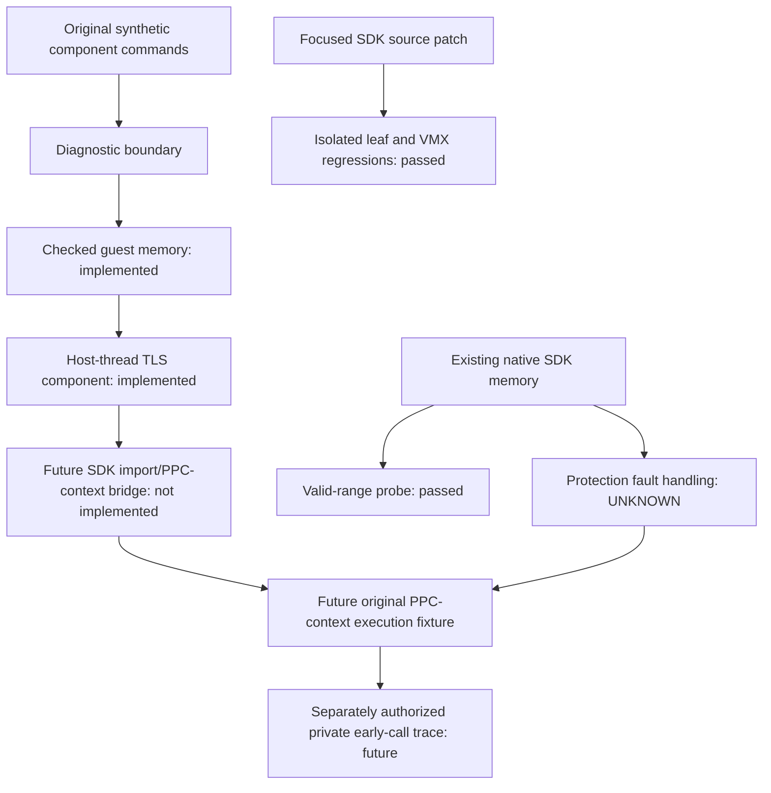

# Runtime foundation — Phase 5

Assessment: **2026-10-20 · v0.0.5-runtime-foundation**. **PARTIAL:** original checked components and focused SDK corrections are implemented and tested. They are not a complete Xbox runtime or a game execution result.

## Baseline and boundaries

`default.xex` SHA-256 remains `636a8036b630ae64acb582de4ac7303b8435de808f67e5343f1ddebc74d29456`. The XEX, Phase 3 manifest/five boundary corrections and all 1,453 generated files were fingerprinted before and after this phase. No original input, title update, prior generated source or installed SDK binary was changed. No analyzer, game compilation, guest entry, graphics/audio initialization or Switch deployment was attempted.

Three distinct levels of evidence must remain separate:

| Level | Implemented / verified | Not established |
| --- | --- | --- |
| Original standalone foundation | Bounded checked memory, process slot allocation/per-thread TLS, diagnostic snapshots and explicit unsupported-operation failure | Full PPC address space, production heap, Xbox ABI/import binding, PCR/r13, native fault translation |
| Focused SDK source patch | Alias-only vector snapshot, TLS bounds/wrap/null checks, explicit unsupported STFS status; isolated actual leaf functions tested and three changed source units pass syntax checks | Complete SDK rebuild/link, integration into the installed runtime or previously generated game code |
| Existing prebuilt host SDK | Real memory-subsystem allocation/mapping/endian/protection-query and lifecycle probe passed without a Runtime/XEX | Sanitizer coverage inside the library, arbitrary invalid-pointer safety, reliable handling of a deliberate protection fault |

The [Phase 4 261-import matrix](runtime-audit.md) describes the **unpatched baseline**: 7 IMPLEMENTED, 184 PARTIAL, 61 STUB, 9 UNKNOWN. This phase does not relabel unsupported STFS as implemented or claim that every import is safe.

## VMX128 evidence and decision

| Classification | Finding |
| --- | --- |
| **VERIFIED HARDWARE BEHAVIOR** | **Unavailable** for the relevant overflow/infinity/rounding/subnormal cases. No new Xbox hardware measurements or independently authenticated special-value corpus was obtained |
| **INDEPENDENT EMULATOR EVIDENCE** | Pinned Xenia master, Xenia Canary, XenonRecomp and ReXGlue disagree in relevant software paths. They share ancestry; they are not four independent hardware confirmations |
| **INFERRED** | IEEE binary16 alone is insufficient as an Xbox oracle. A complete source snapshot fixes the reproduced in-place dependency failure without choosing different numeric semantics |
| **UNKNOWN** | Exact VMX128 numeric contract, hardware flags/flush behavior, actual game inputs and which software implementation matches hardware |

The public hardware/VMX encoding notes and existing Xenia instruction fixtures did not supply hardware-proven special-value coverage for type 5. The [pinned Xenia instruction suite](https://github.com/xenia-project/xenia/blob/95a5c3ee250f80c3b9d139658649d9ffb6db3eec/src/xenia/cpu/ppc/testing/instr_vpkd3d128.s) contains ordinary finite float16_4 examples; these are not proof of every input class. The inspected [VMX128 encoding notes](https://github.com/rexglue/rexglue-sdk/blob/f5337cdc947ff6d4c4196737e2c807a48f2a1fc2/docs/ppc/vmx128.txt) describe the instruction encoding, not an exhaustive conversion truth table.

A significant primary-source caveat is Chuck Walbourn's [DirectXMath 3.03 correction note](https://walbourn.github.io/known-issues-directxmath-3-03/#xmconverthalftofloat-and-xmconvertfloattohalf): it distinguishes an Xbox 360 float16 variant from IEEE conversion and discusses different overflow handling. This is credible library-maintainer documentation, **not a trace of this VMX128 instruction**. Its old software threshold and ReXGlue's threshold are not identical. It prevents treating every IEEE discrepancy from Phase 4 as a proven Xbox defect.

The [Xenia master backend](https://github.com/xenia-project/xenia/blob/95a5c3ee250f80c3b9d139658649d9ffb6db3eec/src/xenia/cpu/backend/x64/x64_seq_vector.cc#L2173) uses round-toward-zero IEEE half conversion. The [XenonRecomp emitter](https://github.com/hedge-dev/XenonRecomp/blob/ddd128bcca99fe8bfbb99bea583c972351fa6ace/XenonRecomp/recompiler.cpp#L2017) has behavior similar to the inspected ReXGlue conversion. Neither is hardware authority.

New pinned **Xenia Canary** evidence: commit `c28af1125d7a50c1cdfc4ba0c7e6c1df5b00f295`. Its [float16_4 path](https://github.com/xenia-canary/xenia-canary/blob/c28af1125d7a50c1cdfc4ba0c7e6c1df5b00f295/src/xenia/cpu/backend/x64/x64_seq_vector.cc#L2866) calls the [Xenos-half helper](https://github.com/xenia-canary/xenia-canary/blob/c28af1125d7a50c1cdfc4ba0c7e6c1df5b00f295/src/xenia/base/math.h) with denormal preservation disabled and nearest-even rounding enabled. That helper's extended-range saturation differs from both IEEE and ReXGlue. An original [comparison runner](../../tests/vmx128/compare_evidence.py) compiled the actual pinned helper and compared 13 synthetic inputs with the actual isolated SDK subject:

| Binary32 input | Canary helper bits | ReXGlue bits | Software observation |
| --- | --- | --- | --- |
| `3F801001` | `3C01` | `3C00` | Rounding differs |
| `33800000` | `0000` | `0001` | Half-subnormal handling differs |
| `477FE001` | `7BFF` | `7FFF` | Upper finite threshold differs |
| `47800000` (+65,536) | `7C00` | `7FFF` | Extended-range representation differs |
| `47FFE000` (+131,008) | `7FFF` | `7FFF` | Same bits; interpretation depends on format |
| `7F800000` / `FF800000` | `7FFF` / `FFFF` | `7FFF` / `FFFF` | Infinity input produces matching bits |

**Decision:** infinity/overflow behavior cannot be declared universally correct or wrong for Xbox from current evidence. No numeric, rounding, mask-warning or subnormal change was applied. Phase 4's IEEE comparison results remain valid **relative to that comparison contract**, not hardware validation.

**Implemented correction:** the SDK patch snapshots all source bits in a scoped `PPCVRegister` before any float16_4 destination write. It fixes the dependency error demonstrated with distinct/same-register cases while preserving scalar conversion and source/destination lane order. It does not regenerate the game, and the 237 previously emitted game operations have no source/destination aliases.

| VMX regression, per build | Baseline | Alias-patched O0 / O2 / ASan+UBSan |
| --- | ---: | ---: |
| Total synthetic invocations | 212,068 | 212,068 each |
| Alias differences, shift 0 | 260 / 260 | **0 / 260** |
| Alias differences, shift 1 | 260 / 260 | **0 / 260** |
| Alias differences, shift 2 | 136 / 260 | **0 / 260** |
| Distinct-register differences | 0 | 0 |
| Finite in-range IEEE truncate differences | 0 / 201,636 | 0 / 201,636 |
| Overflow / infinity / NaN-encoding comparison differences | 8,776 / 4 / 92 | Unchanged |

The updated [VMX runner](../../tests/vmx128/README.md) checks an exact original or alias-patched builder hash. Numeric equivalence to hardware is never a test PASS condition.

## Implemented memory contracts

[Checked memory](../../runtime/checked_memory.h) is an original bounded component arena, default 1 MiB and capped at 64 MiB. It uses synthetic guest base `0x10000000`, 4 KiB reservation accounting and power-of-two page-or-greater allocation alignment. Backing storage is allocated once; no raw host pointer is returned.

- Reserve, commit, whole-allocation protect, decommit and release are distinct operations. Reserved/uncommitted access fails. Newly committed/recommitted memory is zeroed; decommit invalidates existing mapping epochs.
- Translation validates live ownership, complete requested range, commit state and access mode. Reads/writes revalidate the view while holding the arena lock, preventing a release/protection change between translation and use from becoming an unchecked access.
- Subtraction/64-bit arithmetic prevents guest range and allocation-size overflow. Cross-allocation/padding access is rejected. Invalid permissions, zero sizes and unsupported alignments fail explicitly.
- Owner IDs/allocation IDs and mapping epochs reject foreign/forged/stale views. Released addresses are quarantined for the arena lifetime, so stale guest addresses cannot silently alias a new allocation. Released storage is cleared.
- Big-endian word helpers operate through checked byte copies, including unaligned byte ranges. This is not emulation of PPC alignment exceptions.
- Allocation failure/exhaustion is a typed error, never a successful null pointer. Pool construction and metadata allocation failure are explicit; no title memory budget is inferred.

**Limitations:** logical protections are enforced only through these methods, per allocation. This is not host `mprotect`, a recycling heap, full NT virtual-memory semantics, physical aliases, MMIO, executable memory, subrange commit/protect or a guard inserted into generated `REX_LOAD`/`REX_STORE` operations. C++ arena/manager lifetimes must outlive their clients. Arbitrary raw SDK pointers are not made safe by this library.

### Actual prebuilt SDK memory probe

The original [memory-only probe](../../tests/runtime/sdk_memory_probe.cpp) links the unchanged macOS ARM64 SDK and calls `Memory::Initialize` directly. It does not initialize a game Runtime, graphics or audio. **VERIFIED:** allocation and 4 KiB alignment, guest/host round-trip, actual endian reads/writes, region size and protection queries, read-only/read-write protection changes, and virtual reserve → commit → write → decommit → release passed. The probe accessed only valid owned ranges; SDK `TranslateVirtual` itself still computes a raw address without proving allocation ownership.

**UNKNOWN / concrete blocker:** a separate deliberate write to a read-only page did not terminate within **45 seconds**. The child was killed/reaped at the timeout, with core dumps disabled; it was not rerun. Consequently protection-fault delivery/recovery is not verified even though the normal protection queries/changes passed. The uninstrumented prebuilt library's internals are outside ASan/UBSan coverage. Source review of the [POSIX exception callback](https://github.com/rexglue/rexglue-sdk/blob/f5337cdc947ff6d4c4196737e2c807a48f2a1fc2/src/core/exception_handler_posix.cpp) finds no explicit fail-stop/re-raise path after all handlers decline; that is an investigation target, not a proven cause of this timeout. The opt-in fault probe is excluded from normal harness runs and CI.

## TLS requirements, implementation and correction

The fingerprinted XEX metadata specifies 64 four-byte slots and 28 bytes of static data; the tests use original synthetic template bytes with that layout. No game TLS bytes are public. The SDK [thread construction](https://github.com/rexglue/rexglue-sdk/blob/f5337cdc947ff6d4c4196737e2c807a48f2a1fc2/src/system/xthread.cpp#L346) allocates a static prefix followed by dynamic slots and stores related addresses in thread state. The [process allocator](https://github.com/rexglue/rexglue-sdk/blob/f5337cdc947ff6d4c4196737e2c807a48f2a1fc2/src/system/kernel_state.cpp#L327) uses a process slot bitmap and clears freed values across guest threads.

[Original checked TLS](../../runtime/checked_tls.h) implements a process slot pool (1–256 slots), attachment of host threads, independent zeroed guest-addressed storage, bounded static-template initialization, big-endian dynamic values, explicit exhaustion/invalid-slot errors, free/reuse clearing across attached threads and scope-based thread cleanup. Deterministic barriers coordinate two workers plus the main thread; values remain isolated, slot reuse is cleared, a later host thread starts zeroed and all allocations are released. Duplicate/missing attachment and malformed templates fail explicitly. Scopes must stay on their creating host thread and managers must outlive them.

**Partial compatibility:** the static-prefix/dynamic-slot layout and zero/init/isolation rules follow inspected SDK evidence. PCR/r13 layout, guest thread objects, guest process selection, fibers, APCs, dispatch/IRQL and guest scheduler interaction are not implemented by this standalone class. It is not a replacement for KeTls exports or the real XThread lifecycle.

**Confirmed SDK access defects and patch:** with total TLS allocation 284 bytes and a 28-byte prefix, slot 64 is outside the 64 dynamic slots. Old Get/Set bounds use total size; Get also admits its end boundary. `slot * 4` can wrap (for example index `0x40000000`) into slot zero. The patch divides the dynamic byte extent before multiplication, validates null/metadata and uses 64-bit address arithmetic. Exact old/patched methods were compiled against an original guarded backend: baseline out-of-range access and wrap-to-slot-zero were reproduced; patched last-valid slot succeeds and invalid/boundary/wrapped/null/overflow cases fail **without touching memory**. This does not prove all raw guest pointer accesses elsewhere safe. KeTlsFree's success reporting and constructor/template edge cases outside the selected input remain audit items; no unproven return-code change was made.

## Exception and API safety contracts

The baseline `X_EXCEPTION_RECORD` is a 0x50-byte big-endian record containing code, flags, linked record/address, parameter count and 15 information words. That layout is not an unwind implementation. `RtlCaptureContext`, `RtlUnwind` and `__C_specific_handler` remain unimplemented in the installed SDK. `RtlRaiseException` handles debugger naming and reaches C++ exception inspection/debug break; it does not provide general unwinding. [Guest records](https://github.com/rexglue/rexglue-sdk/blob/f5337cdc947ff6d4c4196737e2c807a48f2a1fc2/include/rex/system/xexception.h), [dispatch behavior](https://github.com/rexglue/rexglue-sdk/blob/f5337cdc947ff6d4c4196737e2c807a48f2a1fc2/src/kernel/xboxkrnl/xboxkrnl_debug.cpp#L129).

Phase 4's conservative direct-call closure reaches a possible CRT-related RaiseException path from `xstart`; it is not proof that normal initialization throws. **Necessary now:** reliable PC/register diagnostics, explicit refusal of unsupported exception operations and safe component cleanup. **UNKNOWN for game execution:** real context capture, cleanup funclets, throw/rethrow/dispatch/unwind and host access-fault translation requirements. These must be separated from optional debugger naming.

[Diagnostic boundary](../../runtime/execution_boundary.h) copies original synthetic register/PC state into an outcome and reports typed failures. The harness demonstrates unsupported guest exception handling as an explicit failure and cleans up its host TLS scope. This snapshot is **not** an Xbox CONTEXT record, and C++ host cleanup/catching is **not** guest unwinding. Existing void guest exception shims were not changed to fabricated status returns or a speculative exception subsystem.

**STFS correction:** the two source shims now warn and return `0xC0000002` / `X_STATUS_NOT_IMPLEMENTED`, rather than success. The SDK already defines that status; its meaning is documented in [MS-ERREF](https://learn.microsoft.com/en-us/openspecs/windows_protocols/ms-erref/596a1078-e883-4972-9bbc-49e60bebca55). Unsupported calls leave outputs unchanged and never dereference potentially invalid buffers. Regression checks include a valid sentinel output and deliberately unusable pointers: rejection is observable and no fabricated device/output is produced. This supplies failure semantics, not STFS functionality or proof the game checks that status.

**RtlCompareMemoryUlong decision:** the SDK and pinned Xenia contain the same word-count implementation, including an endian FIXME. Microsoft documents a Windows byte-count contract, but this is not independent proof of the Xbox export. No blind guest API behavior change was applied. It remains PARTIAL and excluded from any claim of runtime-correct initialization. XamAlloc's unchecked failure, KeTlsFree reporting, raw translations, session/device success stubs and the remaining Phase 4 imports are not silently considered fixed.

## Test results and reproducibility

Host: Apple Clang 17.0.0, macOS ARM64. Original foundation/SDK-leaf tests use C++20; optional prebuilt SDK memory and full-unit syntax checks use C++23 / `SPDLOG_FMT_EXTERNAL`. No global packages were installed.

| Validation | Result |
| --- | --- |
| Six original foundation groups at O0 / O2 / ASan+UBSan | **PASS**, identical test outcomes, no compiler/runtime diagnostics |
| Seeded memory model | **4,000** operations per build; byte-array expectations, legal writes and rejected out-of-range cases |
| Deterministic TLS | 64-slot boundaries/exhaustion and static template; three simultaneous host threads; free/reuse and later-thread cleanup checks **PASS** |
| Three exact SDK leaf groups at O0 / O2 / ASan+UBSan | **PASS**: TLS regression, STFS failure, valid protection-flag conversions |
| Patch application | Original source hashes verified; private-copy apply/check **PASS** |
| Patched XThread / I/O / vector full source syntax | **PASS**; existing SDK FPCR operand-width warning in XThread/I/O retained |
| Actual prebuilt SDK memory-only probe | **PASS** for valid-range allocation/mapping/protection queries and lifecycle |
| Deliberate native read-only write | **UNKNOWN**, child timeout at 45 s; no repeat or game execution |
| Alias-patched VMX O0 / O2 / ASan+UBSan | **PASS regression**, zero alias differences; numeric comparison gaps unchanged |
| Canary helper comparison | **13 synthetic inputs** executed; software disagreements retained as evidence, not hardware truth |

Commands and output conventions: [runtime harness](../../tests/runtime/README.md), [VMX/evidence runner](../../tests/vmx128/README.md), [SDK patch](../../patches/rexglue-sdk/README.md). All SDK-derived extracts, objects, executables, logs and results stay private. CI compiles/runs the original dependency-free foundation only; optional SDK probes require the user's existing public SDK checkout/binary locally. Sanitizer success does not validate guest semantics or the uninstrumented prebuilt SDK.

## Dependency graph and next milestone

Reference comparison stays pinned to [project8-sw](https://github.com/R-drg/project8-sw/tree/3393f2615deb7e8ac11ce51d2cd0e9defded5669), [Simpsons](https://github.com/R-drg/the-simpsons-game-nx/tree/3cb2cdf7fa1665a1f2d653aa7502fe4baa03680f) and [Mercenaries2](https://github.com/penettrator/Mercenaries2-NX/tree/65167852496f94b278a82ffea465c51703575f01). Their native platform layers separate guest mappings, fibers/threads, host fault recovery and title hooks; that separation informs this component-first design. Project8's platform/FP/SIMD patches do not prove guest unwind correctness or fix the identified TLS bounds/STFS shims for this baseline. No title-specific patch or reference implementation was copied. The SDK patch retains BSD-3-Clause terms/notices; original foundation/tests remain GPL-3.0-only. [Prior compatibility/license comparison](runtime-audit.md#reference-runtime-comparison-and-reuse-boundary).

**Next task:** isolate the bounded native protection-fault failure with stack/CPU diagnostics and establish a deterministic fail-stop/recovery contract. Then connect a tiny **original PPC-context fixture** to a reviewed subset of actual SDK memory/TLS exports, with checked ownership and a whitelist of supported imports. That is the next execution milestone; it must not load or boot the game. Independently resolve Xbox numeric evidence and guest exception requirements before any separately authorized private entry trace. Full game execution, graphics/audio integration and Switch deployment remain out of scope.
