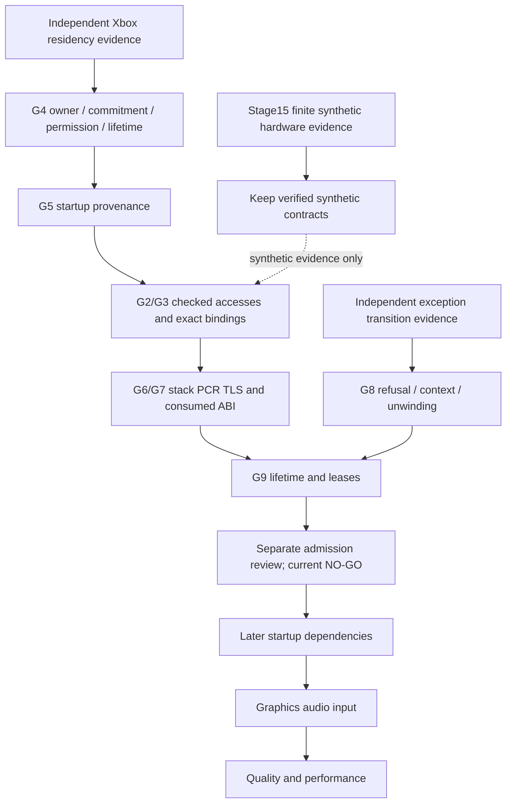

# Stage 16 — title compatibility requirements

## Evidence baseline

Stage15 **HARDWARE VERIFIED**, by the user's explicit observation of Candidate
0.15.0 build `80407778989c`: PASS427/FAIL0, generated result197650,
SDK entered64/completed61, guest allocations0, leases0; PLUS returned to hbmenu.
NRO SHA256 `b95c5287dd970d55da687f938c7360888d7f28ed8af5cbfbc54270b6d030faf2`.
ZIP SHA256 `ba84bd1595ef27f7936c5ecd0a034f0870f43b00467c566d749ae63dbc0b60e3`.
These identify the preserved artifact; no new screenshot was inspected here.
Historical build manifests keep their build-time UNKNOWN hardware field.

The reported raw libnx applet type0 maps to `AppletType_Application` in pinned
libnx4.12.0 (`nx/include/switch/services/applet.h`); it is not enum LibraryApplet.
The user's phrase “Applet Mode” is retained as a launch description, not used to
infer Title Override, available memory, firmware, kernel permissions or hbmenu mode.
The hardware result covers the observed finite workload, not all runtime paths.

Evidence keys: H = user-attested Stage15 hardware result above;
S = [Stage12–15 source, host and build report](switch-hardware-acceptance.md);
X = preserved Phase21 and blocked Phase22 evidence (read-only, private detailed
receipts); public [Phase21 contracts](bounded-entry-runtime-contracts.md).
I = actual source inspection at baseline `a82371d`.
A = hardware synthetic, B = host synthetic, C = preserved Xbox research,
D = earliest frozen title region, E = later startup. UNKNOWN means unestablished,
not a requirement inferred from generic Xbox behavior.

## Traceable requirements matrix

Each row identifies its coverage, dependency and next proof. P0 blocks any title
admission; P1 blocks subsequent startup; P2 concerns later subsystems; P3 concerns
quality/performance. D requirements remain mandatory even if the region has no
normal imports. H evidence is never automatically transferred to D.

| ID / priority / contract | A and B: implementation and coverage | C: title evidence | D: earliest region / dependency | E: later startup / risk, feasibility and next proof |
| --- | --- | --- | --- | --- |
| R01 P0 image allocation/owner | H/S: original flat synthetic XEX only; `runtime/horizon/xex.h`, `space.h` own and lease ranges | X: original SDK loader refuses; one PE virtual tail lacks owner evidence | Required; G4 BLOCKED. Descriptor bytes cannot authorize extra extent | High risk; external Xbox allocation/commit/content/permission/owner/lifetime evidence before any correction |
| R02 P0 initial memory/values | H/S: authored constants, explicit zero-fill within committed allocations | X: static decoded bytes available; live initial title values UNKNOWN | Required; R01 then G5 UNKNOWN | High risk; prove consumed startup bytes/registers and provenance; no synthetic substitute |
| R03 P0 generated memory mediation | H/S:49 instrumented sites (45 scalar,4 full vector) in203 authored words; checked capability/permissions/endian | X: preserved compile-only8 stores/20 hook references; no invoked private hook bodies | Required; G2/G3 PARTIAL offline, live admission blocked; R01/R02; no new game compilation | High risk; separately reviewed offline generation/binding provenance and runtime contracts, not larger synthetic denominator |
| R04 P0 CFG/stop boundaries | H/S:97 hooks,4 backedges,17 call sites,20 returns,11 branch edges; `generated.h`, strict ControlPlan | X: frozen19 instructions plus one unexecuted pre-call boundary;4 blocks,2 ranges,19 normal edges,0 loops | Required; frozen audit is not execution admission; R03/R05 | Bounded stop cannot interrupt arbitrary native syscall; prove proposed boundaries and exact binding |
| R05 P0 fault/refusal/unwind | H/S: typed Error, structured trace, host RAII; `generated.h`, `diagnostics.h`; no Xbox CONTEXT dispatcher | X: required guest exceptional transfer semantics missing | G8 BLOCKED; observed host refusal alone insufficient | High risk; fault-time context and required Xbox exception transitions must be established; no guest continuation |
| R06 P0 stack/PCR/TLS and ABI | H/S: real PPCContext, own16KiB guest stack, native TLS, selected r1/r2/r13 and scalar/FPR tests; `guest.h` | X: Phase21 synthetic XThread only; title PCR/stack provenance not admitted | R02/R05, G6 PARTIAL; full Xbox ABI UNKNOWN | Prove exact consumed fields and signature, not every possible ABI; typed-vector marshalling refused |
| R07 P0 module lifetime | H/S: active execution/import leases block unload; transactional rollback, handle ownership | X: preserved SDK synthetic leases/rollback; title-wide allocation fails | R01/R06, G9 PARTIAL; no live original module | General rule host-testable; original owner and neighbor/lifetime rule still external |
| R08 P0 identity/publication/budget | H/S: production generator, pinned hashes, deterministic NRO, watchdog and cancellation | X: source hash and private compile receipts; no guest invocation | G1/G10/G12 PASS within original gate definitions; G11 PARTIAL offline | Preserve source, privacy, watchdog, no original execution; these gates alone cannot admit entry |
| R09 P1 ordinary imports | H/S: exactly4 Horizon exports, narrow signatures; `xex.h`, `query.h`, `fill.h` | X:274 recognized import records /261 function shims is identity inventory, not implementation coverage | Frozen region needs0 normal imports; save-helper call is not an SDK export | Actual subsequent startup dependency UNKNOWN; admit only proven required call/signature/error/ownership |
| R10 P1 integer/control semantics | H/S: authored subset including cntlzw/selected rlwinm; production codegen audited | X: frozen instruction classification exists privately | Required only for actual frozen slice, not a whole ISA | No new opcode justified by this audit; independent oracle first |
| R11 P1 FPR/vector ABI | H/S: selected finite scalar FPR; full-block lvx/stvx/vadduwm/vxor; typed-vector signatures denied | X: no new required vector/FPR ABI established for frozen slice | Not newly established as a D dependency | Later requirements UNKNOWN; preserve partial-vector/typed-vector refusal |
| R12 P1 reservation atomics | A/B unsupported and denied; no Xenon granule/order oracle | No required reservation opcode established in D | Not an invented D requirement | BLOCKED semantics; a plain host CAS is insufficient |
| R13 P1 scheduler/exception continuation | H/S: native workers and own GuestTask, not Xbox scheduler | X: incomplete guest dispatch/unwind | Required exceptional behavior governed by R05; no universal scheduler assumed for D | Required later paths UNKNOWN; independent ordering/context/lifetime evidence |
| R14 P2 graphics/audio/input/filesystem | No title implementation; console UI/native input only | No startup-safe contracts derived here | Outside D; cannot unblock P0 | Identify dependencies after P0/P1 evidence; do not add no-op services |
| R15 P3 performance/full compatibility | Finite smoke/stress only | No gameplay evidence | Outside D | Profile only an admitted workload; no percentage-of-game estimate |

## Measured readiness and dependency graph

Denominators are artifacts, not game completion:21 synthetic functions,203 words,
49 memory sites,97 hooks;4/4 configured Horizon imports with scoped contracts.
These do not measure title import compatibility. Static title evidence:215/215
page descriptors pass the content hash chain over14,090,240 decoded bytes;
13/14 declared PE section spans fit that extent. Neither ratio proves live owner,
RSA authenticity or extra allocation. Frozen title region:19 admitted offline
instructions,0 proprietary instructions executed in this work;0/0 required normal
SDK imports in that frozen region, which says nothing about later startup.

Original mandatory G1–G12 evidence status (not redefined):3 PASS (G1/G10/G12),
6 PARTIAL (G2/G3/G6/G7/G9/G11),1 UNKNOWN (G5),2 BLOCKED (G4/G8). The later
Recovery III table supersedes the earlier pre-offline table retained in the
protected report; PARTIAL offline artifacts still do not satisfy live admission.
This carries forward preserved evidence and is not an upgrade from this work.
No completion percentage.

Highest-priority proof path: R01 and R05. More synthetic opcodes or SDK stubs
cannot resolve either. Stage17 tests the current ownership rule independently;
Stage18 may strengthen diagnostic evidence without claiming Xbox continuation.

## Switch roadmap Stages20–22 evidence update

[Independent source audit](xex-loader-reference-audit.md) and
[14-case source-slice differential](xex-synthetic-loader-differential.md) reinforce
R01: raw/virtual declarations, security size and image allocations are distinct;
NONE/BASIC/NORMAL allocation paths must be treated separately. A larger section
still supplies no owner. Reference B is not full Xenia Memory/LoadContinue.
Its unmodified PE path has a confirmed UBSan null-member offset defect; an
explicit one-line observation variant is separate and does not change policy.
R05 remains blocked: the reviewed reference RtlRaiseException is a stub/debugger
path with incomplete unwind, not an independent Xbox exception oracle.
[Gate/property review](xex-gate-evidence-review.md) retains G4/G8 BLOCKED and
G5 UNKNOWN. [Optional observation protocol](xbox-hardware-observation-protocol.md)
requires a qualified pre-entry image-owner channel; ordinary self-reporting
cannot observe before its own entry. No title contract/gate is promoted and no
new Horizon-specific behavior or NRO is introduced.
