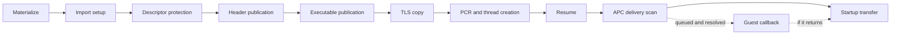

# Bounded title writer/observer contract — T53–T64

2026-11-04. Baseline `50956729d06b360bfc06320e35d2f73b0e58bb6f`.
**Earliest actual observer UNKNOWN; title RW draft BLOCKED; entry NO-GO.**
This cycle reviews the relevant pinned implementation paths and existing finite
title evidence. No new guest-memory abstraction, production C++ change, original
PPC generation/compilation/execution, runnable title image or NRO is introduced.

## Window and partial order

The proposed investigation begins immediately after image materialization,
including all subsequent binding/publication/provider/thread effects, and ends at
the selected post-second-store, pre-unproved-call boundary. Provider activity may
already exist before materialization and may continue during the window. The
boundary is a static analysis boundary, not a verified original runtime stop.
Offline source verification is a separate audit event; it supplies no live
happens-before edge. No total historical launch order is established.

| Event | Applicable evidence | Original-title timing/effect |
|---|---|---|
| Source verification / saved A/B | VERIFIED artifact identities and target equality | Not a live entry snapshot |
| Materialization | Pinned SDK owned image path; saved source interval | Actual historical state UNKNOWN |
| Provider initialization | Configured kernel-init callback / provider constructors | Configuration, ordering and lifetime incomplete |
| Import binding | Direct slot spans disjoint from targets | Other provider effects not excluded |
| Protection / module-header publication | Ordered on successful SDK load path | Not a proven original load completion |
| Executable-module publication | SDK process metadata and exported cell updates | Actual module/aliases UNKNOWN |
| TLS/PCR / thread creation | SDK fresh allocation, template copy, PCR setup | Original context/observers UNKNOWN |
| Startup transfer | SDK raw-start or configured trampoline after APC delivery | Original path UNKNOWN |
| First title instruction / first store / second store | Preserved conditional normal-prefix order | Occurrence/completion not proved |
| First consumer | No established applicable earliest target read | UNKNOWN |
| Stop/return | Finite pre-call analysis boundary | Runtime stop/return not admitted |

Within one successful configured main-launch path, source establishes:



These edges require the same applicable successful invocation and configuration.
They are not Xbox timing authority. Separate static title evidence gives
entry → first fixed store → second fixed store → pre-call boundary **if the
selected normal path completes**. It cannot be composed with SDK edges to prove
actual historical execution. Timer ticks, optional DLL attachment, other threads
and first target consumer have no complete applicable placement in this order.

## Provider side effects: scoped findings

All 13 original provider identities, source hashes, pointer inputs, symbolic
write ranges and remaining unknowns are retained in one private ledger. Public
categories below avoid exposing the detailed title import map.

| Provider group | Explicit reviewed SDK effects | Qualification |
|---|---|---|
| Four video objects | Fresh physical-system allocations, scalar/cell writes and bounded critical-section initializer | Disjointness depends on successful allocation and valid backing/lifetime |
| Two monitor objects | Config-dependent cell/object allocation and clearing | Trampoline construction is commented out here; no historical absence claim |
| Two version/hardware objects | Fresh system allocations and selected fields/constants | Emulation-selected values do not establish title requirements |
| Command-line object | Aligned fresh buffer zeroing and host-string copy | Configuration-dependent length and consumers remain separate |
| Executable-module cell | Fresh cell, later module-handle publication; process fields in KernelGuestGlobals | Real title identity and import-visible alias lifetime unproved |
| Time bundle | Initial fields plus repeating native callback to a captured bundle field | Potential concurrency and translated-pointer lifetime must be accounted for |
| Two object-type subobjects | KernelGuestGlobals initialization/pool tags and host export mapping | Object users/callback contracts and original lifetime remain unproved |

`SetVariableMapping` changes host resolver metadata; it does not itself write the
target interval. `SystemHeapAlloc` requests reservation/commitment/RW, checks size,
sets an allocation owner argument and zeroes requested bytes. The reviewed provider
calls do not establish title-specific ModuleLife ownership simply by using that
allocator. Error behavior and original allocations are not inferred from the
successful-path reasoning. No historical pointer is transferred into native use.

No direct initializer store to the two target words is identified in these scoped
bodies. Under successful nonoverlapping allocator ownership, their explicit writes
are confined to their own destinations. **This is conditional exclusion for the
reviewed implementation, not a full title writer/observer closure.** Global users,
helper effects outside the reviewed bounds, callbacks, asynchronous lifetime,
configuration and actual runtime identities remain obligations. No provider is
implemented or newly admitted; all 13 remain unadmitted for title execution.

## TLS, PCR, thread and publication findings

The original XEX TLS template's saved range is disjoint from the target interval.
In the pinned `CreateWithModule`/`CreateInternal` path an image lease protects
module TLS metadata; newly allocated TLS is cleared, template bytes are copied
into it, and a separate PCR receives thread/process/TLS/stack pointers. This bounds
explicit copy/read destinations only under the valid allocation/translation
premises. It does not prove original runtime values or callback behavior.

A concrete unresolved pre-entry path is now explicit: `XThread::Execute` calls
`OnThreadExecute`, then **DeliverAPCs before choosing/invoking the startup target**.
`DeliverAPCs` may dispatch registered kernel and normal guest routines with
queue/scratch-derived arguments. Actual queue contents, resolved routines, their
reads/writes and pointer retention are not established for the title. The scan
may find no work; neither that case nor an actual target observer is proved here.

The reviewed `OnThreadExecute` contains an assertion and a TODO rather than a
complete DLL-thread notification implementation. Optional DLL process attachment
exists elsewhere under specific load/thread/call-entry conditions. These source
limitations are not evidence that the original platform/title has no callbacks.
The raw-start versus trampoline branch and runtime kernel initialization callback
are configuration-dependent. Original launch configuration and equivalent native
omission/admission rules cannot be guessed.

## Eight-byte transition and alias ledger

Let `U` denote unknown live target bytes; `L/R` are the independently verified
four-byte store effects. Detailed values and coordinates remain private.

| State | Proven conclusion |
|---|---|
| Saved source A/B | Equal source bytes; not live-entry identity |
| Direct import slot fixups | Target-disjoint spans under reviewed implementation |
| Other pre-entry work | Live target `U` and observers remain UNKNOWN |
| First store completes | `L + U[4:8]`, absent competing writes |
| Second store completes | `L + R`, absent competing overlapping writes |
| First observation / stop | No complete applicable boundary/consumer proof |

Known direct IAT slots and the TLS template range are disjoint. Fresh provider/TLS/
PCR objects are conditionally disjoint under allocator ownership and valid lifetime.
Original r1-derived save slots, computed addresses, APC/DLL arguments, provider-held
pointers, persistent consumers and the incomplete relocation/pointer universe do
not have a complete alias exclusion proof. Saved B pointers are not reused.

The previously analyzed first callee's fixed image-global read/write is a different
location and does not establish a reader of these target words. Its pointer-derived
loads and unknown calls do not supply a no-alias summary. No recursively expanded
full-game reference scan is performed. Absence of direct references in this finite
set is not absence of indirect observers. **Earliest actual observer is UNKNOWN.**

## Conditional theorem and tooling

Final target-byte substitution is CONDITIONALLY PROVEN only if both correct-width
BE32 stores execute at the verified destinations in the required order, ownership/
commitment/RW rights and lifetime hold, no fault/stop/exception exposes the
intermediate state, no relevant intervening observer/alias is omitted, no competing
overlapping writer changes the outcome, and the observation occurs at the declared
post-pair boundary. It does not prove that the original title reaches this state.

Existing original symbolic tests demonstrate complete overwrite independence and
counterexamples for early/intermediate observation, alias mutation and an unwritten
byte. A fault/stop after the first store exposes the same partial-state witness;
a concurrent writer can similarly defeat the claimed final effect. Endianness
remains a verified instruction-semantic premise, not something inferred from a
particular uniform payload. Full guest context, return and exceptions remain
separate obligations.

`tools/observation_order.py` adds a finite evidence-scoped partial-order checker
used directly on the private event ledger. It validates endpoints, evidence labels,
budgets and cycles; reachability uses only PROVEN edges from the requested scope
and explicitly adopted conditions. Missing edges yield UNKNOWN, not no observer.
SDK/native facts cannot silently close historical paths. Invalid queries fail
rather than masquerade as unknown evidence. Evidence citations remain manually
audited facts; the tool does not authenticate them, solve guard satisfiability,
model periodic scheduling or prove a whole title execution.

```sh
python3 tests/observation-order/test_order.py
python3 tests/image-write-authority/test_contract.py
```

Six new original tests cover partial ordering, scope separation, unknown-edge
refusal, conditional callback edges, cycles and malformed queries. Focused local
validation totals six bounded processes, 75 unittest cases plus an unchanged
fixture-identity script. It includes the existing overwrite, original instruction,
startup dependency and module-provider static checks. Unexpected failures and
timeouts: zero. New runtime refusals, PPC runs and bytewise-runtime counters: zero.
Local sanitizer execution is **N/A**: no production C++ changes occurred. Runtime
and existing fixture fingerprints match the verified prior profiles; no large
regeneration/rebuild campaign is repeated. Hosted CI runs the portable existing
C++/sanitizer jobs and the new partial-order tests separately.

## T61–T64 decision and different acquisition method

T53/T54 partial timeline/state ledger and the finite source audit in T55–T59 are
completed within explicit scope. Live historical ordering, first observer and
complete alias closure remain UNKNOWN. T60 target-byte theorem is conditional;
T61 title RW authority and T62 private candidate remain **DRAFT/BLOCKED**.
No new title mapping or permissive validation is introduced. T63 targeted tests
and T64 audit complete the finite cycle; no T65 is started.

Generic memory capability is VERIFIED in its prior scope. Source-byte identity
and fixed-write geometry are VERIFIED. A bounded admitted title data object,
full NativeImagePlan and original executable image remain BLOCKED. Game entry is
NO-GO. The 392-byte gap, virtual tail and SizeOfImage remainder stay inaccessible.
Original startup registers, PCR/TLS/thread identity, 13 providers, unknown callees,
image lifetime and six exception-overlapping sites remain separate blockers.
Historical **G4 BLOCKED / G5 UNKNOWN / G8 BLOCKED**.
Native **N-G4 BLOCKED / N-G5 PARTIAL / N-G8 BLOCKED**.

**The smallest missing independent evidence is an applicable full-window
writer/observer and callback/thread ordering record for the exact target bytes,
anchored to identified post-materialization, pre-entry and post-pair boundaries.**
Current sources do not recover the original APC queue, launch configuration,
actual aliases/observers or live lifetime/rights. Another nearly identical
source-only cycle cannot establish those facts.

The next action should therefore be to qualify a different evidence channel:
authorized real-hardware observation/trace or an authoritative startup contract.
A minimal protocol must identify module/source/context, reservation/commitment/
rights/owner, values at the boundaries, relevant reads/writes and alias/thread/
callback ordering throughout the window, plus a bounded stop before unproved
continuation. Boundary snapshots alone cannot prove no intermediate observers.
No qualified interface is currently available; no device connection, security
bypass, firmware change or original execution is authorized by this report.
Preserve BLOCKED until such evidence is accessible, rather than inventing another
synthetic success milestone. No acquisition experiment is run in this cycle.
